# Manual de usuario de Aztarna

Este manual explica cómo usar **Aztarna** (en euskera, «huella, rastro») para
mantener las pruebas y los requisitos y para apuntar sus resultados cuando se
ejecutan. No hace falta saber programar ni conocer el formato de los archivos.

## Contenido

1. [Qué es y cómo se organiza](#1-qué-es-y-cómo-se-organiza)
2. [Abrir el editor](#2-abrir-el-editor)
3. [La ventana](#3-la-ventana)
4. [Editar pruebas (modo Pruebas)](#4-editar-pruebas-modo-pruebas)
5. [Requisitos y trazabilidad (modo Requisitos)](#5-requisitos-y-trazabilidad-modo-requisitos)
6. [Ejecutar y validar (modo Validación)](#6-ejecutar-y-validar-modo-validación)
7. [Importar desde Word](#7-importar-desde-word)
8. [Atajos de teclado](#8-atajos-de-teclado)
9. [Preguntas frecuentes y problemas](#9-preguntas-frecuentes-y-problemas)
10. [Robot Framework: guía para quien escribe los tests](#10-robot-framework-guía-para-quien-escribe-los-tests)

---

## 1. Qué es y cómo se organiza

El editor trabaja con cuatro cosas distintas:

- **Las pruebas.** Qué hay que probar: título, parametrización, situación
  inicial, ensayo, imágenes… Están en una **carpeta de pruebas** que mantiene
  el equipo, organizada en **capítulos**, y dentro de cada capítulo en
  **secciones** (que pueden tener subsecciones).
- **Los requisitos.** Qué tiene que cumplir el producto. Están en una
  carpeta `requisitos`, junto a la carpeta `pruebas`, organizados también en
  capítulos y secciones. Cada prueba indica qué requisitos cubre; con eso el
  editor sabe qué requisitos tienen pruebas y cuáles no (la
  **trazabilidad**).

- **Las ejecuciones.** Una ejecución es una tanda de pruebas que una persona
  pasa sobre una versión concreta y en un **entorno de pruebas** (Automático,
  Maqueta o Torre), por ejemplo «Regresión v2.3 en torre». Guarda qué pruebas
  entran y el resultado de cada una. Cada persona guarda sus ejecuciones donde
  quiera en su PC.
- **Las validaciones.** Una validación une las ejecuciones de una versión,
  normalmente de varias personas y entornos, y da el resultado de cada prueba
  en cada entorno: una prueba queda **validada** cuando ha salido OK en todos
  los entornos que pide.

```text
proyecto/
├── pruebas/       indice.yaml, un archivo por capítulo e imagenes/
└── requisitos/    indice.yaml y un archivo por capítulo
```

Por eso el editor tiene tres modos, que se eligen arriba a la izquierda:

| Modo | Para qué |
|---|---|
| **Pruebas** | Crear, cambiar, mover y borrar pruebas. |
| **Requisitos** | Crear, cambiar, mover y borrar requisitos, y ver qué pruebas cubren cada uno. |
| **Validación** | Pasar las pruebas de una ejecución y apuntar el resultado, y unir ejecuciones en la validación de una versión. En este modo las pruebas no se pueden cambiar. |

Los resultados **nunca** se escriben en las pruebas: se guardan en la carpeta
de la ejecución.

> **El ID de cada prueba es su «DNI».** Cada prueba tiene un identificador
> (por ejemplo `DEMO-LLAM-001`) que debe ser **único** y **no cambiar**. Las
> ejecuciones reconocen cada prueba por su ID: si se cambia, para ellas pasa a
> ser otra prueba. El editor no deja repetir un ID y pide confirmación antes
> de cambiarlo.

---

## 2. Abrir el editor

- **Windows:** abre `Aztarna.exe`. La primera vez pide una carpeta:
  la del proyecto (la que contiene `pruebas` y `requisitos`) o directamente
  la de pruebas (la que contiene el archivo `indice.yaml`); después la
  recuerda.
- **Linux:** desde la carpeta del proyecto, `python editor_web.py`.

Cada persona tiene su copia del programa. Cuando salga una versión nueva,
cópiala: la versión que tienes está abajo a la derecha. Si otra persona guardó
la carpeta con una versión más nueva y los datos cambiaron de formato, tu copia
la abrirá en solo lectura y te pedirá que la actualices (no la estropea).

Para cambiar de carpeta de pruebas, pulsa el botón de la carpeta en la barra
superior.

El editor recuerda, de una vez para otra, la carpeta de pruebas, el modo en
que lo dejaste, la última validación y ejecución, el ejecutor, el ancho del
panel izquierdo y la última carpeta elegida en los diálogos (que se abren
allí). Lo guarda en los ajustes de tu PC (en **⋯ → Acerca de** se ve dónde).

### Varias personas en la misma carpeta

Si la carpeta está en una unidad de red y la abren varias personas, cada
**capítulo** solo lo puede editar una a la vez. Al hacer tu primer cambio en
un capítulo, el editor lo reserva a tu nombre (el **ejecutor** que usas en las
ejecuciones o, si no, tu usuario de Windows). Quien lo abra mientras tanto lo
ve así:

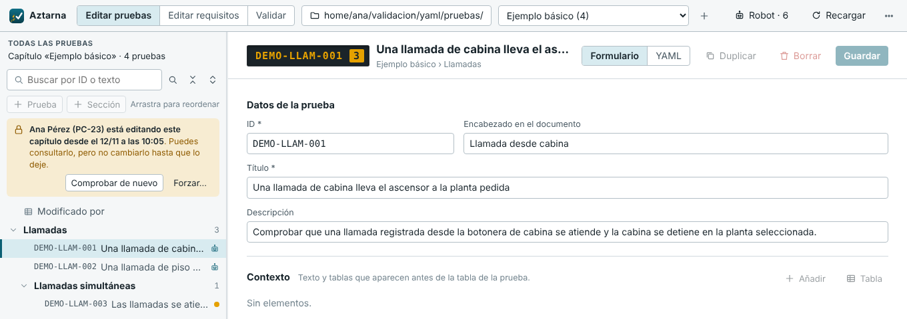

Puede leerlo (también en la vista YAML), pero no cambiarlo ni guardarlo; los
demás capítulos están libres. El aviso desaparece solo cuando lo dejas: al
cambiar de capítulo, de modo o de carpeta, al cerrar el editor o tras 15
minutos sin cambios (si no tienes nada sin guardar). Si un editor se cierra
mal, la reserva caduca en 5 minutos. **Forzar…** la quita antes; úsalo solo si
sabes que la otra persona no lo está usando, porque no podrá guardar lo que
tenga a medias.

El editor usa el tema claro u oscuro de tu sistema. Para cambiarlo:
en Windows, *Configuración → Personalización → Colores → Modo de aplicación*;
en Ubuntu, *Configuración → Apariencia*.

---

## 3. La ventana

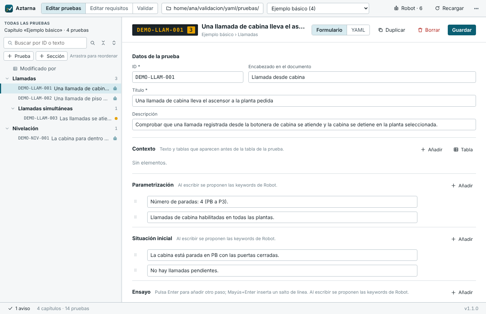

- **Barra superior:** modo (Pruebas / Requisitos / Validación), carpeta de
  pruebas, en el modo Validación la validación y la ejecución abiertas,
  capítulo, *Robot* (configuración de Robot Framework y número de pruebas
  automatizadas), *Recargar* (vuelve a leer los archivos del disco) y el
  menú **⋯** (ver abajo).
- **Panel izquierdo:** buscador (por ID o texto) y el **árbol** del capítulo
  con sus secciones y pruebas. Las secciones se pliegan y despliegan con la
  flecha; los dos botones junto al buscador **pliegan** o **despliegan todas**
  a la vez. El ancho del panel se ajusta arrastrando su borde.
- **Zona central:** la prueba o sección seleccionada. Con la ventana
  maximizada, el formulario se ensancha para aprovechar la pantalla.
- **Barra inferior:** resultado de la validación (errores y avisos), el
  aviso de *Cambios sin guardar* y, a la derecha, la versión del editor (al
  pulsarla se abre *Acerca de*).

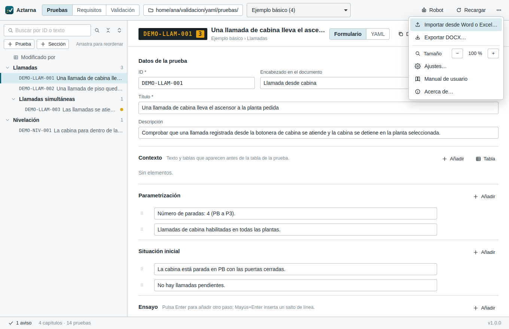

El menú **⋯**, a la derecha de la barra superior, reúne:

- **Importar desde Word…**: pruebas, requisitos o resultados de una
  ejecución (ver 7). En el modo Validación, solo resultados.
- **Exportar DOCX…** (en el modo Requisitos, *Exportar DOCX de requisitos…*):
  ver 4.8. No aparece en el modo Validación.
- **Tamaño**: **−** y **+** agrandan o reducen todo (texto, botones,
  imágenes); el porcentaje vuelve al 100 %. Ver abajo.
- **Ajustes…**: tu nombre, dónde se publica el programa y la dirección de las
  incidencias (ver abajo).
- **Manual de usuario**: abre este manual en una ventana aparte.
- **Acerca de…**: versión, dónde guarda este PC sus ajustes, enlace al
  proyecto en GitHub y botón del manual.

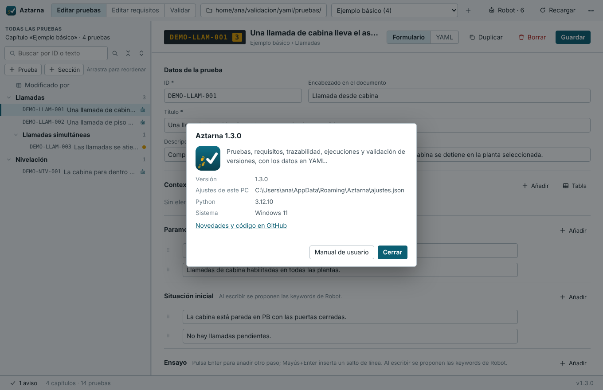

**Tamaño (zoom).** Para leerlo todo más grande: **Ctrl + rueda del ratón**,
**Ctrl +** / **Ctrl −** o *⋯ → Tamaño*; **Ctrl 0** vuelve al 100 %. Va del 67 %
al 300 % y se recuerda en este PC. Con la ventana estrecha o mucho zoom, la
barra superior deja solo el icono en *Robot* y *Recargar*, y al pasar una
prueba el panel del resultado se pone encima de la prueba.

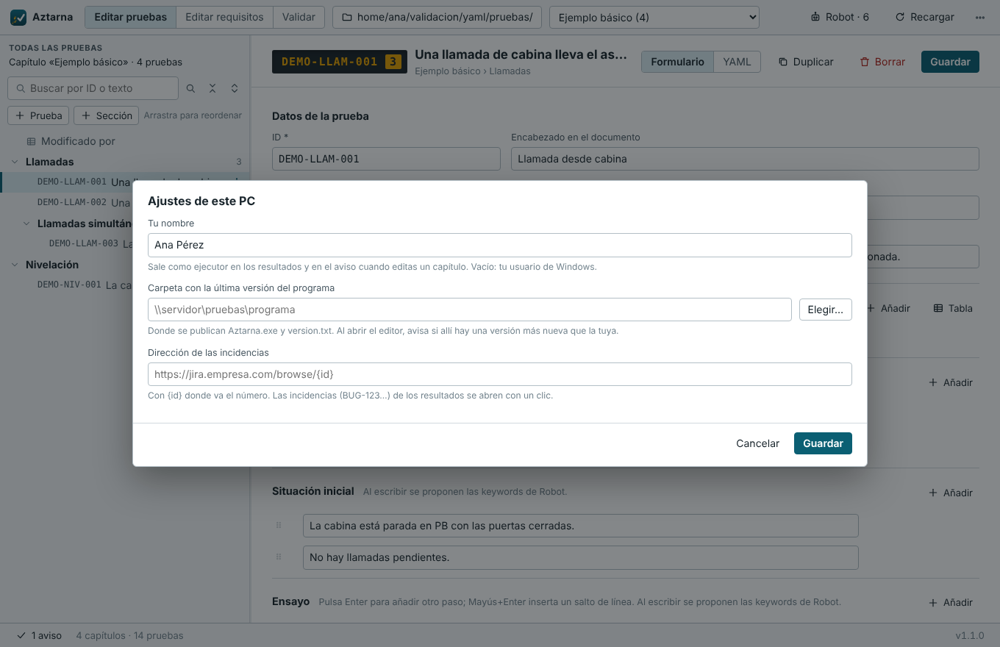

**Ajustes de este PC** (*⋯ → Ajustes…*):

- **Tu nombre**: sale como ejecutor en los resultados y en el aviso cuando
  editas un capítulo (vacío: tu usuario de Windows).
- **Carpeta con la última versión del programa**: la carpeta compartida
  donde se publica `Aztarna.exe` con su `version.txt`. Al abrir el
  editor, si allí hay una versión más nueva que la tuya, un aviso lo dice y
  ofrece abrir la carpeta.
- **Dirección de las incidencias**: la de tu gestor de incidencias (Jira,
  Redmine…) con `{id}` donde va el número, por ejemplo
  `https://jira.empresa.com/browse/{id}`. Así las incidencias de los
  resultados (`BUG-123`) se abren con un clic.

**Esperas.** Lo que tarda (abrir una validación grande, generar un informe,
importar) muestra una ruleta con el tiempo que lleva. Si una espera pasa de
8 segundos aparece **Ocultar y seguir trabajando**: la operación sigue y su
resultado se verá al terminar.

Cuando avises de un problema, indica la versión que aparece aquí; también
figura en el pie de los informes y en las propiedades de los documentos de
Word que genera el editor.

---

## 4. Editar pruebas (modo Pruebas)

### 4.1 Editar una prueba

Selecciona la prueba en el árbol. A la izquierda de su título aparece una
placa con su ID y el **nivel** de título que tendrá en el documento.

El formulario sigue el orden de la tabla de la prueba en el documento:

- **Datos de la prueba:** ID y título (los dos **obligatorios**, marcados con
  \*), encabezado en el documento y descripción.
- Las listas de **Contexto** (texto y tablas que van antes de la tabla),
  **Parametrización**, **Situación inicial** y **Ensayo** (numerado), ver
  4.3.
- **Maniobra** y **Entorno de pruebas** (por ejemplo, Automático, Maqueta,
  Torre): marca todas las que correspondan. Sus opciones son las del proyecto
  (ver «¿De dónde salen las opciones de Maniobra y Entorno?», en 9).
  **Automatizable**: una opción de la lista.
- **Requisitos:** los IDs de los requisitos que cubre la prueba. Al escribir
  el ID o parte del título se proponen los del catálogo; **Intro** añade el
  elegido y la **×** lo quita. Un requisito que no existe sale en **rojo** y
  uno que ha cambiado desde la última revisión, en **ámbar** (ver
  [5.4](#54-cuando-un-requisito-cambia)). Pulsa un requisito para abrirlo.
- **Tags:** palabras para agrupar pruebas (`regresion`, `smoke`,
  `seguridad`…). Al entrar en el campo se proponen los que ya usan otras
  pruebas, los más usados primero y con cuántas pruebas los llevan; al
  escribir, la lista se filtra. **↑ / ↓** y **Intro** (o **Tab**, o un clic)
  añaden el elegido; si no hay ninguno que sirva, **Intro** o una **coma**
  añaden lo escrito. Son el criterio principal para elegir qué pruebas entran
  en una ejecución, así que conviene usar siempre los mismos nombres.

  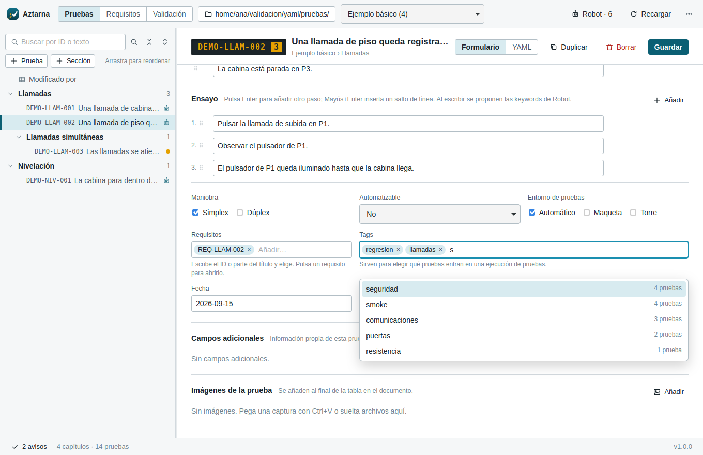
- **Fecha** y **Versión**.
- **Campos adicionales:** información de la prueba que no tiene sitio en la
  tabla; sale en filas al final de ella. Cada campo tiene un nombre y un
  valor; los que son listas se escriben con un elemento por línea.
- **Imágenes de la prueba:** se añaden al final de su tabla en el documento.

Pulsa **Guardar** (o **Ctrl+S**). Mientras haya cambios sin guardar verás
*Sin guardar* junto al título; si intentas ir a otra prueba o cerrar la
ventana, el editor pregunta si quieres guardarlos.

Otros botones de la cabecera:

- **Duplicar:** abre una prueba nueva con los mismos datos, justo después de
  esta y con el ID vacío para que le pongas uno nuevo.
- **Borrar:** pide confirmación. Al borrar una **sección**, sus pruebas no se
  borran: suben un nivel.
- **Descartar:** aparece solo con cambios sin guardar; los deshace y vuelve a
  mostrar lo que hay guardado.
- **Formulario / YAML:** ver 4.6.

### 4.2 Dar formato al texto

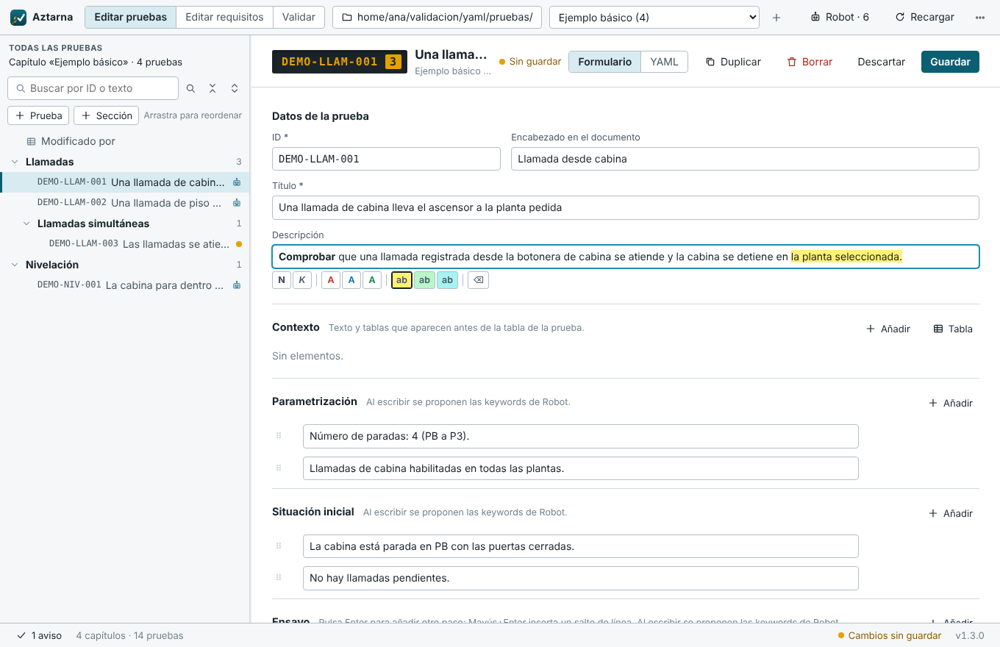

Al escribir en la descripción o en una lista aparece la **barra de formato**.
El formato se ve directamente mientras escribes:

| Botón | Hace |
|---|---|
| **N** | Negrita (Ctrl+B) |
| *K* | Cursiva (Ctrl+I) |
| **A** roja / azul / verde | Color del texto |
| **ab** amarillo / verde / cian | Resaltado |
| ⌫ | Quita todo el formato |

- Con texto seleccionado, el botón aplica el formato; si todo lo seleccionado
  ya lo tenía, **lo quita** (pulsar resaltado amarillo sobre un texto
  amarillo lo deja sin resaltar).
- Sin selección, el formato se aplica a lo que escribas a continuación.
- El botón del formato activo aparece marcado.
- **Ctrl+Z** deshace y **Ctrl+Y** rehace (texto y formato).

### 4.3 Listas: pasos, situaciones y contexto

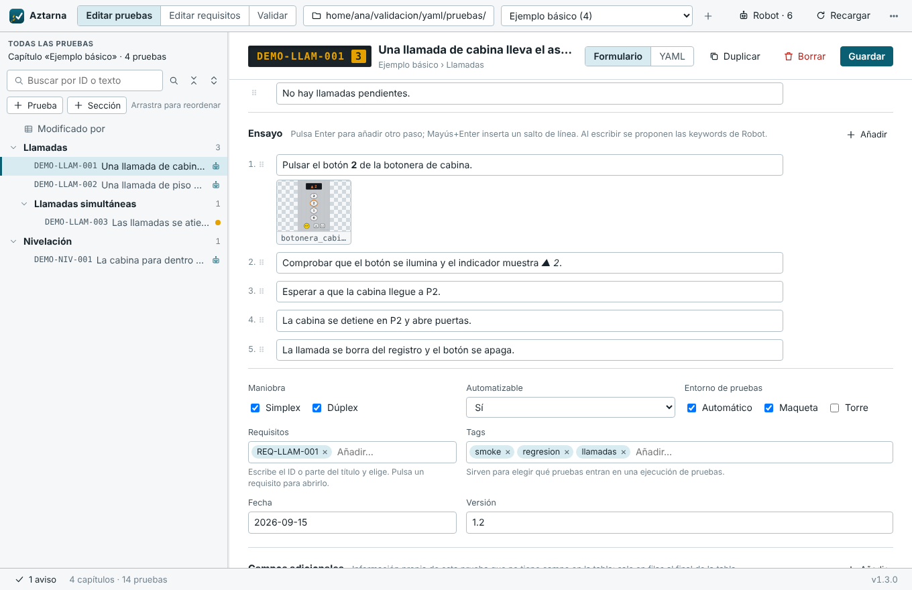

Cada elemento es una fila. Los pasos se numeran solos.

- **Intro** crea una fila nueva debajo; **Mayús+Intro** hace un salto de
  línea dentro de la misma fila.
- **Retroceso** en una fila vacía la borra.
- **Alt+↑ / Alt+↓** mueve la fila; también se puede arrastrar por el asa (⠿).
- Los botones de sangría convierten una fila en **subpunto** de la anterior.
- **Imágenes de una fila:** botón de imagen, pegar una captura con **Ctrl+V**
  o soltar el archivo encima de la fila. La imagen se copia a la carpeta
  `imagenes/` de las pruebas y aparece en miniatura; haz clic para verla en
  grande o en la × para quitarla.
- **Keywords de Robot:** si está configurado Robot (ver
  [6.7](#67-pruebas-automáticas-robot-framework)), al escribir una
  situación o un paso se proponen las keywords de Robot que encajan con lo
  escrito. Ver [más abajo](#escribir-los-pasos-con-las-keywords-de-robot).

#### Escribir los pasos con las keywords de Robot

Si en el botón **Robot** está configurada la carpeta de los tests de Robot,
el editor conoce sus keywords (las de los `.robot`, los `.resource` y las
librerías de Python). Al escribir en *Parametrización*, *Situación inicial*
o *Ensayo* aparece una lista con las que encajan con lo escrito, con
sus argumentos, su descripción y dónde están:

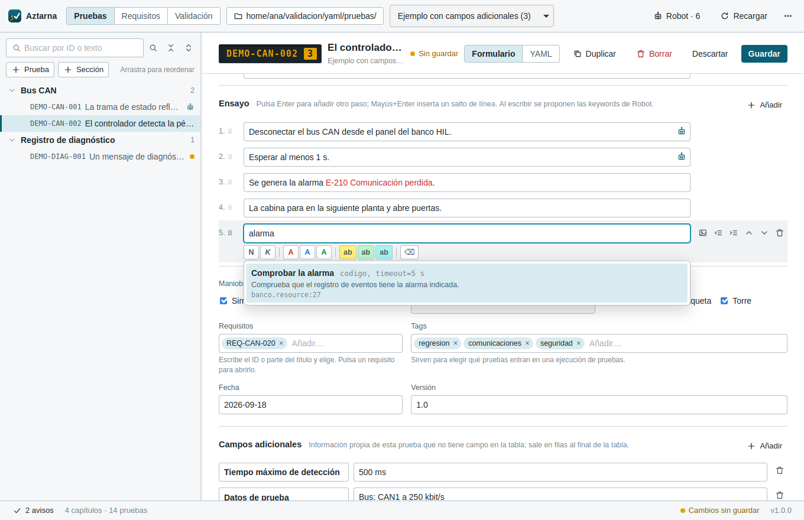

- **↑ / ↓** para moverse por la lista, **Intro** o **Tab** para elegir,
  **Esc** para cerrarla y seguir escribiendo a mano.
- Al elegir, el paso queda escrito como en Robot y el cursor se coloca donde
  hay que poner el dato: en `Registrar una llamada de piso en ${planta}`
  queda seleccionado `${planta}` (escribe `P3` encima); en
  `Comprobar la alarma    codigo=` el cursor queda tras `codigo=`.
- Los pasos que ya son una keyword llevan un **robot** a la derecha (pasa el
  ratón por encima para ver cuál y dónde está).

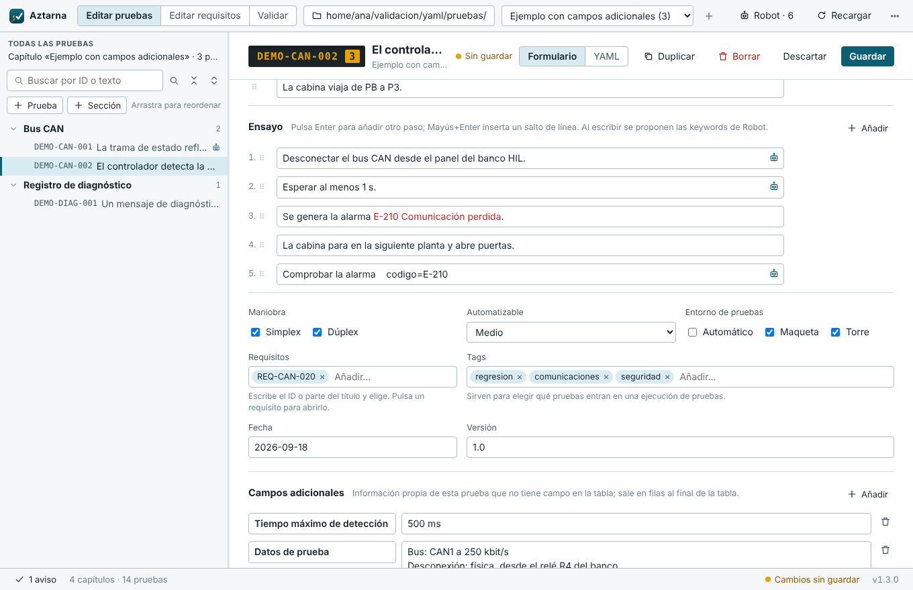

No es obligatorio: un paso puede seguir siendo texto libre. Pero si las
pruebas nuevas se escriben con las keywords, el tester y Robot hacen
exactamente los mismos pasos, y será más fácil automatizarlas.

### 4.4 Crear pruebas y secciones

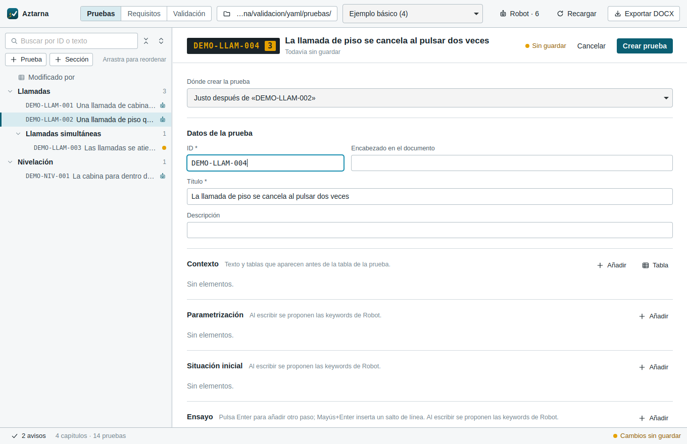

Usa **+ Prueba** o **+ Sección** del panel izquierdo (las tablas se añaden en
el contexto, ver [4.9](#49-tablas-que-no-son-pruebas)). Elige **dónde** crearla:
justo después de la prueba seleccionada, dentro de una sección (al final) o
al final del capítulo. El nivel de título se calcula solo. Rellena los datos
y pulsa **Crear prueba** (o **Crear sección**).

### 4.5 Reordenar

Arrastra pruebas y secciones en el árbol. Al soltar sobre una sección, según
la posición, el elemento queda **antes**, **dentro** (al final) o **después**
de ella. Una sección se mueve con todo su contenido (también las tablas de su
contexto) y los niveles se ajustan solos.

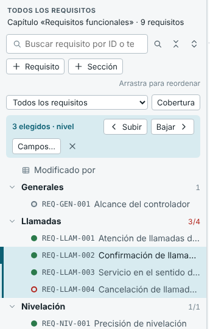

Para **cambiar el nivel de varios a la vez**, elígelos con **Ctrl+clic** (uno
a uno) o **Mayús+clic** (un rango): aparece una barra con **Subir** y
**Bajar** (un nivel cada vez) y la **×** para quitar la selección (o Esc).
**Alt+←** / **Alt+→** hacen lo mismo, también con el elemento abierto. Una
sección se mueve con todo lo que cuelga de ella. Los niveles van del 2 al 6
(el 1 es el capítulo): si alguno se saldría, no se cambia nada y el editor
dice cuál.

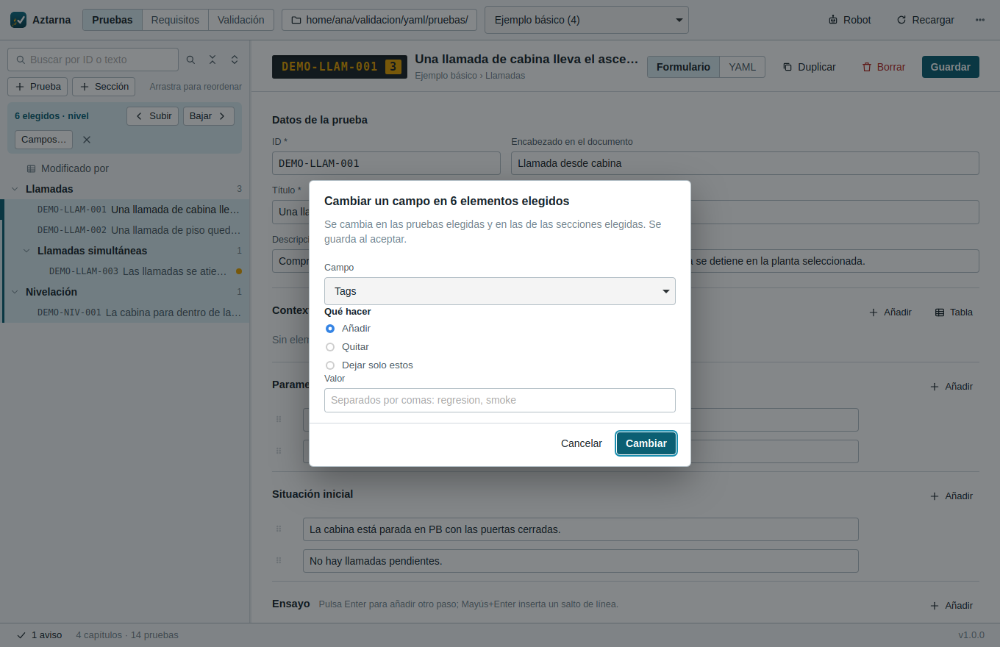

Con varios elegidos, **Campos…** cambia un mismo campo en todos: *Tags* y
*Requisitos* (añadir, quitar o dejar solo esos), *Maniobra*, *Entorno de
pruebas*, *Automatizable*, *Versión* o *Fecha*. Si eliges una sección, se
cambia en todas sus pruebas. Se guarda al aceptar; los capítulos que edita
otra persona se saltan.

### 4.6 Vista YAML

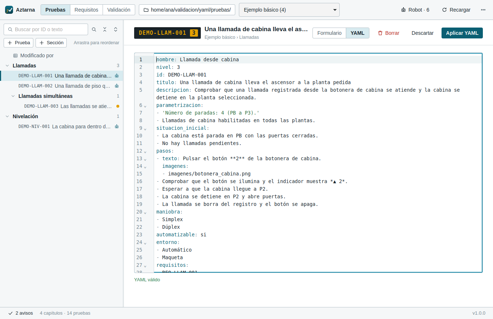

El botón **YAML** muestra la prueba tal como está guardada en el archivo, por
si hace falta un cambio que el formulario no permite. Si hay un error, se
señala la línea. **Aplicar YAML** guarda; **Descartar** vuelve al formulario
sin cambios. En el uso normal no hace falta.

### 4.7 Validación

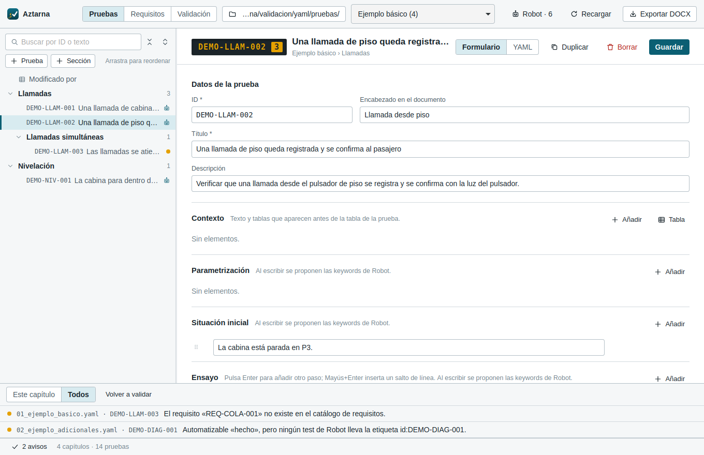

El editor revisa las pruebas en segundo plano. La barra inferior muestra el
número de errores y avisos; al pulsarla se abre la lista (de este capítulo o
de todos). Haz clic en un problema para ir a la prueba. En el árbol, las
pruebas con problemas llevan un punto rojo (error) o ámbar (aviso).

Revisa: IDs repetidos o vacíos, pruebas sin título, imágenes que no existen,
valores de maniobra, entorno o automatizable que no son una opción, campos
que ya no existen (de un formato antiguo), niveles de título fuera de rango y
requisitos citados que no existen en el catálogo.

### 4.8 Exportar a Word

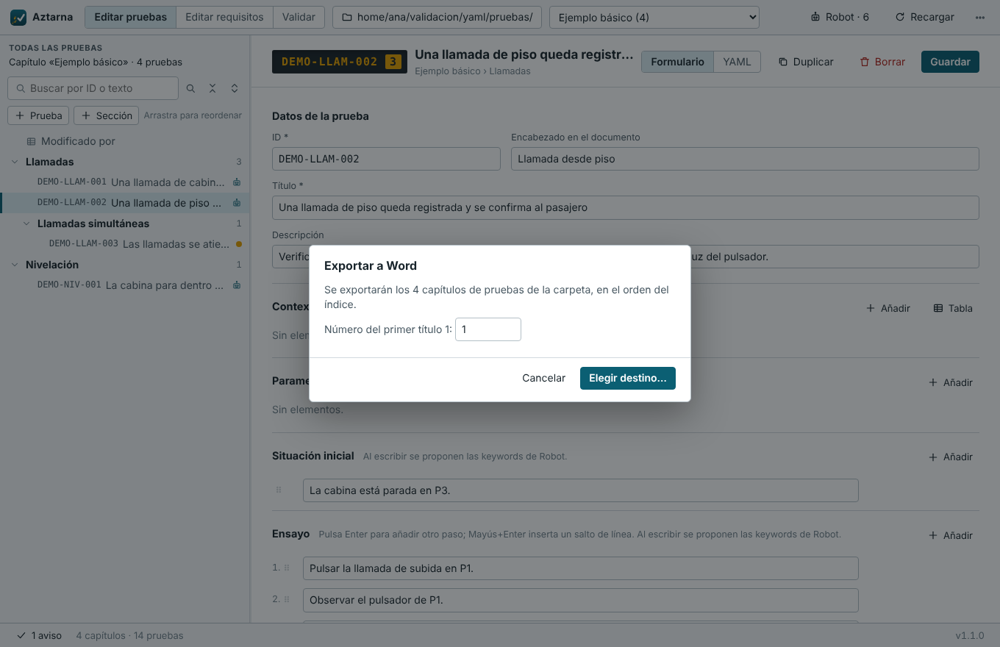

**⋯ → Exportar DOCX…** genera un documento de Word con todos los capítulos,
en el orden del índice, con títulos numerados y una tabla por prueba. Puedes
indicar el número del primer título (por ejemplo, 8 si el documento original
empezaba en el capítulo 8). Después eliges dónde guardarlo; mientras se genera verás
una ruleta (con muchas pruebas e imágenes puede tardar un poco). El documento
es una copia para leer o compartir: los cambios se hacen siempre en el editor.

---

### 4.9 Tablas que no son pruebas

El documento también tiene tablas que no son pruebas: historial de cambios,
tablas de parámetros… Van en el **contexto** de una sección o de una prueba,
entre sus párrafos, igual que en el Word, y se exportan tal cual. Al importar
el Word original se colocan ahí solas.

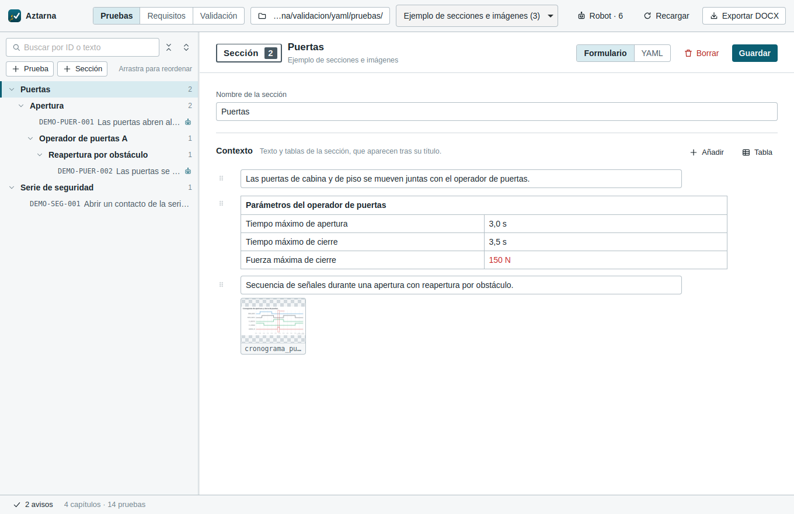

- Se ven como una tabla normal. **Haz clic en ella para editarla**; para
  terminar, **Hecho** o **Esc**.
- **Tabla** (en la cabecera del contexto) añade una tabla nueva de 2 × 2.
  Las flechas la suben o bajan entre los párrafos y la papelera la quita.

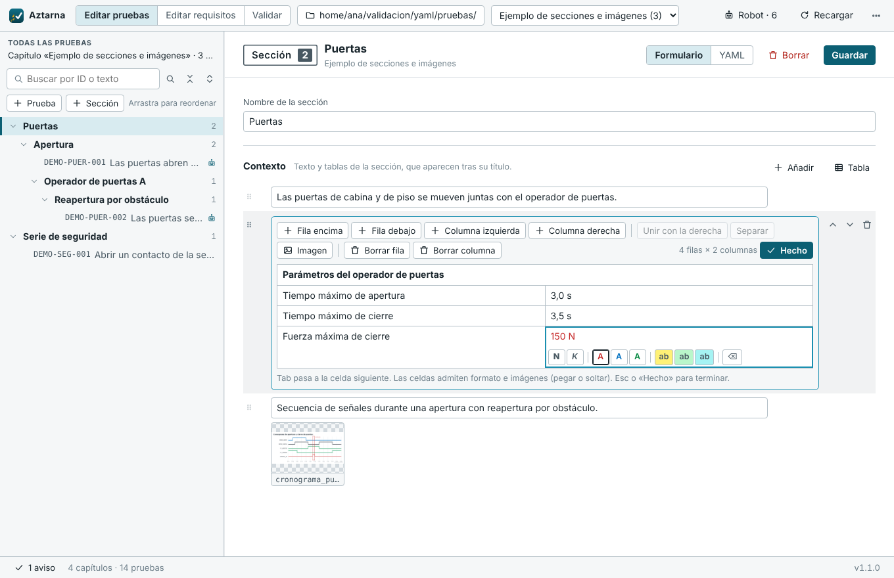

Mientras se edita:

- Haz clic en una celda para escribir; **Tab** pasa a la siguiente. Las
  celdas admiten el mismo formato que el resto del texto (negrita, colores,
  resaltado) y saltos de línea con **Intro**.
- Con una celda elegida, los botones de encima añaden **filas** (encima o
  debajo) y **columnas** (a la izquierda o a la derecha) o las borran.
- **Unir con la derecha** junta una celda con la siguiente (por ejemplo, para
  un título que ocupa toda la fila); **Separar** lo deshace.
- **Imagen** añade una imagen a la celda; también se puede pegar una captura
  (**Ctrl+V**) o soltar el archivo encima.

Como el resto del contexto, los cambios se guardan con **Guardar**.

Las tablas que van **antes del primer título** del capítulo (por ejemplo, el
historial de cambios al principio) no tienen sección: aparecen en el árbol
con un icono de tabla y se editan igual.

En modo Validación, las tablas del contexto se ven (sin editar) en la ficha
de la prueba o de la sección.

### 4.10 Buscar y reemplazar en todos los capítulos

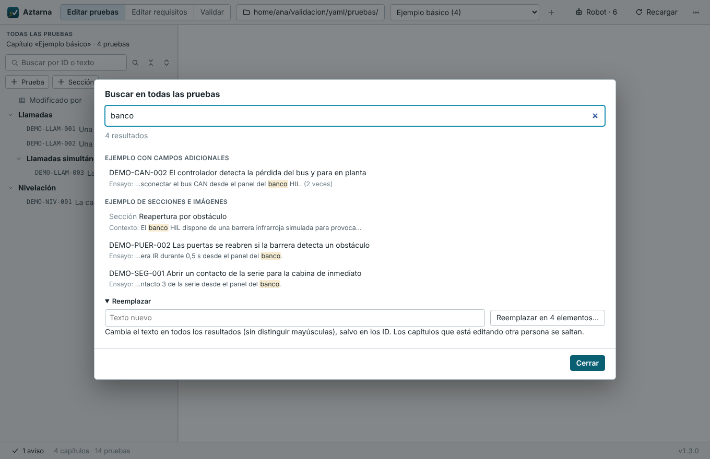

El buscador del panel izquierdo busca en el capítulo abierto. Para buscar en
**todos los capítulos**, pulsa la lupa junto al buscador o **Ctrl+Mayús+F**:
sale cada prueba, sección o tabla con el texto, en qué campo está y un trozo
alrededor. Pulsa una para ir a ella (Intro va a la primera).

**Reemplazar** cambia el texto en **todos** los resultados (sin distinguir
mayúsculas), aunque la lista solo muestre los 500 primeros. No toca los ID y
se salta los capítulos que está editando otra persona. Si cambia el texto de
un requisito con pruebas, queda con sus pruebas por revisar, como al editarlo
a mano. Con Git se puede deshacer; sin Git, no.

## 5. Requisitos y trazabilidad (modo Requisitos)

Los requisitos se editan igual que las pruebas: árbol con capítulos y
secciones, **+ Requisito** y **+ Sección**, arrastrar para reordenar, vista
YAML, validación y **⋯ → Exportar DOCX de requisitos…** (un documento con una tabla por
requisito). La diferencia es que el editor relaciona cada requisito con las
pruebas que lo citan en su campo **Requisitos**.

Si todavía no hay requisitos, el modo Requisitos ofrece **Crear
requisitos**: crea la carpeta `requisitos` (junto a la carpeta `pruebas`) con
un primer capítulo.

### 5.1 Cobertura

Cada requisito tiene un estado, que se calcula solo:

| Estado | Marca | Significa |
|---|---|---|
| **Cubierto** | punto verde | Al menos una prueba lo cita. |
| **Sin cobertura** | círculo rojo | Se valida con pruebas y ninguna lo cita. |
| **No aplica** | círculo gris | Es *Informativo*, o se valida solo por inspección o análisis. |

Un requisito se valida con pruebas si su **Criterio validación** incluye
**Test** o si no tiene criterio. En el árbol, cada sección muestra cuántos de
sus requisitos tienen pruebas (por ejemplo, `3/4`), en rojo si falta alguno.

### 5.2 El panel de cobertura

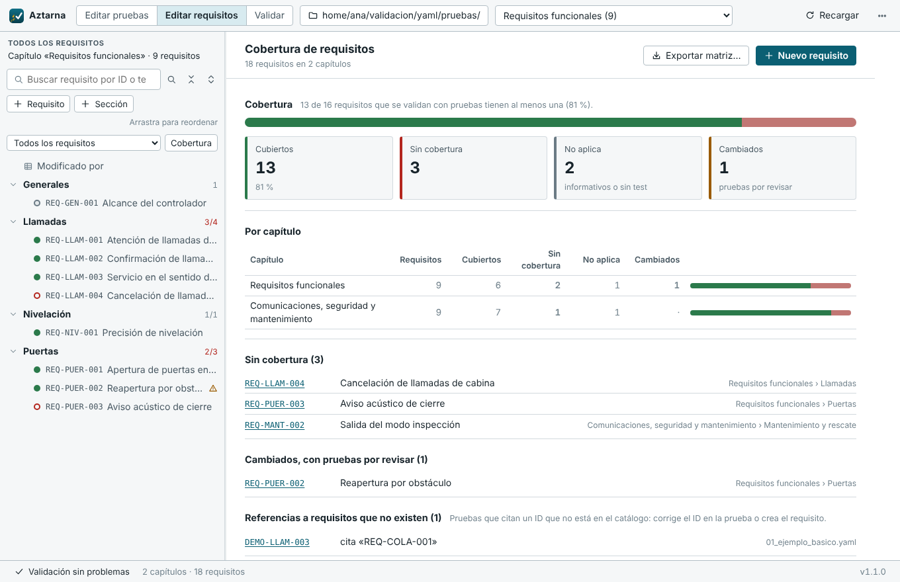

Al entrar en el modo Requisitos (o con el botón **Cobertura**) se ve el
resumen de todos los capítulos:

- el porcentaje de requisitos cubiertos y las cifras de cada estado; al
  pulsar una cifra, el árbol muestra solo esos requisitos (también se puede
  elegir en la lista de encima del árbol);
- una tabla por capítulo (pulsa una fila para abrir el capítulo);
- las listas de requisitos **sin cobertura** y **cambiados**, las pruebas que
  citan un requisito **que no existe** y, plegadas, las **pruebas sin
  requisito**. Pulsa un ID para ir a él;
- **Exportar matriz…** guarda la matriz de trazabilidad en un CSV que se abre
  con Excel: una fila por requisito con su estado y las pruebas que lo
  cubren.

### 5.3 Editar un requisito

El formulario sigue la tabla del requisito en el documento: **ID** y
**Título** (obligatorios), **Descripción**, **Fuente**, **Referencia**,
**Tipo** (Informativo, Obligatorio u Opcional), **Criterio validación**
(Inspección, Análisis o Test; se pueden marcar varios), **Fase**, **Fecha** y
**Versión**, y el **Contexto** (texto y tablas que van antes de la tabla).

Si la descripción tiene **tablas o imágenes** (lo normal al importar del
Word), van en el bloque **Tablas e imágenes de la descripción**, en su orden y
con los párrafos que las siguen; en el Word exportado salen dentro de la celda
de la descripción. Los **Campos adicionales** guardan lo que no tiene campo
propio (por ejemplo, una «Prioridad» del Word) y salen en filas al final de la
tabla.

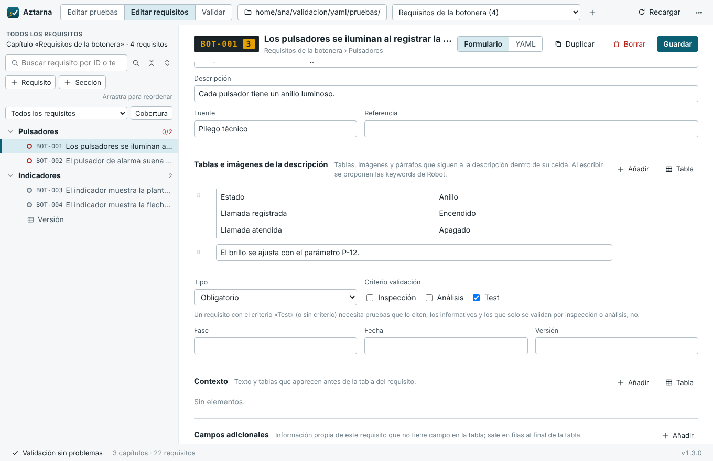

Encima está el bloque **Pruebas que lo cubren**, con su estado y la lista de
pruebas: pulsa una para abrirla (el editor pasa al modo Pruebas).

Para cubrir un requisito, añade su ID en el campo **Requisitos** de la
prueba:

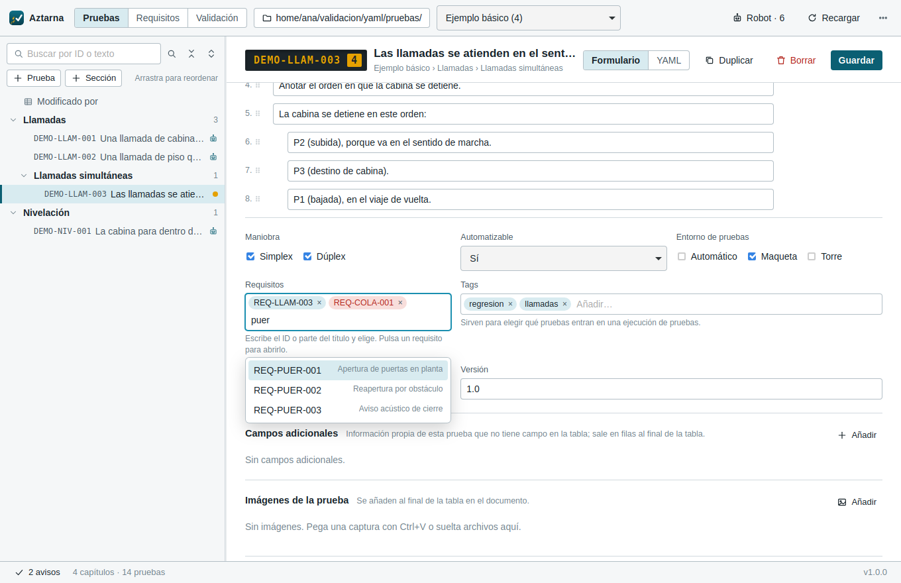

### 5.4 Cuando un requisito cambia

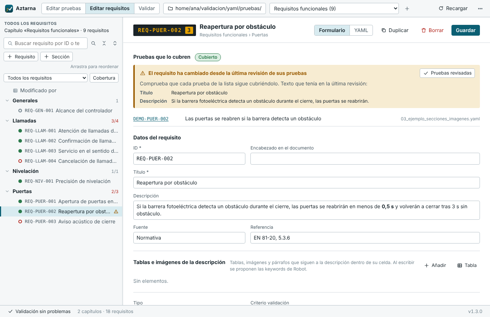

Si cambias el **título**, la **descripción** o el **contexto** de un
requisito que tiene pruebas, puede que esas pruebas ya no lo verifiquen
bien. El editor lo marca como **cambiado** (⚠ en el árbol, ámbar en las
pruebas que lo citan) y en su ficha muestra el texto que tenía en la última
revisión.

Revisa las pruebas de la lista, adáptalas si hace falta y pulsa **Pruebas
revisadas**: el aviso desaparece. Si deshaces el cambio, el aviso se quita
solo. Cambiar la fecha, la versión, el tipo o el criterio no cuenta como
cambio.

### 5.5 Cambiar el ID de un requisito

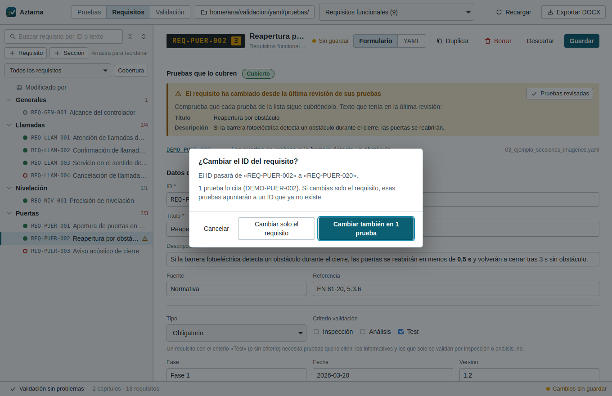

Las pruebas citan cada requisito por su ID. Al cambiarlo, el editor dice
cuántas pruebas lo citan y ofrece **cambiarlo también en ellas**. Si cambias
solo el requisito, esas pruebas quedan citando un ID que no existe (salen en
el panel y en la validación).

---

## 6. Ejecutar y validar (modo Validación)

El trabajo habitual tiene dos pasos:

1. **Cada persona pasa sus pruebas** en una o dos **ejecuciones**, cada una en
   un entorno (por ejemplo, Luis en la torre y Ana en la maqueta). Se crean en
   su PC, sin necesidad de validación (6.2 a 6.9).
2. **Alguien une las ejecuciones** de todos en la **validación de la versión**
   y genera el informe final (6.10).

### 6.1 Los resultados posibles

| Resultado | Significa | Tecla |
|---|---|---|
| **OK** | Se ejecutó y el resultado es el esperado. | 1 |
| **NO OK** | Se ejecutó y el producto no se comporta como se espera. | 2 |
| **Bloqueada** | No se pudo ejecutar por algo ajeno al producto: banco averiado, falta hardware, depende de otra prueba que falló… | 3 |
| **No aplica** | No aplica a esta versión o configuración. | 4 |
| **Pendiente** | Aún sin ejecutar. | 0 |

El porcentaje de OK se calcula sobre las pruebas que aplican.

### 6.2 Crear una ejecución

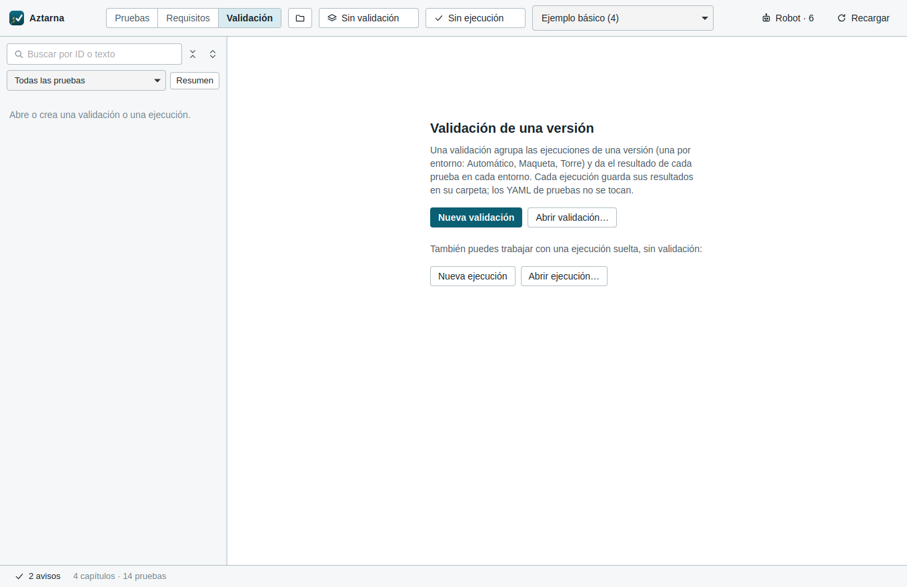

Pasa a **Validación** y pulsa **Nueva ejecución** (o el botón de la ejecución,
✓, en la barra superior).

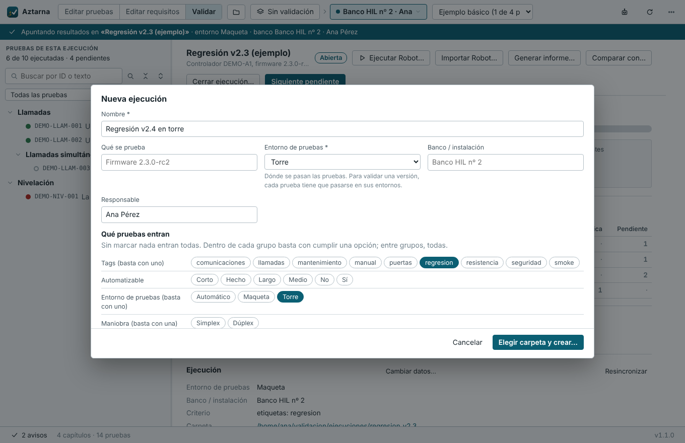

1. Escribe el **nombre**, elige el **entorno de pruebas** (Automático, Maqueta
   o Torre; es obligatorio) y, si quieres, qué se prueba (la versión), el banco
   o instalación y el responsable. Al elegir el entorno se marcan las pruebas
   que lo piden.
2. Marca **qué pruebas entran**: tags, automatizable, entorno de pruebas,
   maniobra o capítulos. Dentro de un grupo basta con
   cumplir una opción; entre grupos, hay que cumplirlas todas. Sin marcar nada
   entran todas. Debajo ves la lista de pruebas que entrarán.
3. Pulsa **Elegir carpeta y crear…** y elige dónde guardarla. Se crea una
   subcarpeta con la fecha y el nombre (por ejemplo
   `2026-11-03_Regresión_v2.4`).

La lista de pruebas queda fijada al crearla. Si después alguien etiqueta otra
prueba, entra con **Resincronizar** (en el resumen).

### 6.3 Abrir una ejecución

Botón de la ejecución → **Abrir ejecución…** o una de las **recientes**. Al
entrar en el modo Validación se abre la última que usaste (o la última
validación). Al abrir una
ejecución se abre también su carpeta de pruebas.

Si la carpeta de pruebas se ha movido (o la ejecución viene de otro PC), el
editor lo avisa y te pide que indiques dónde está; lo recuerda para la
próxima vez.

### 6.4 El resumen

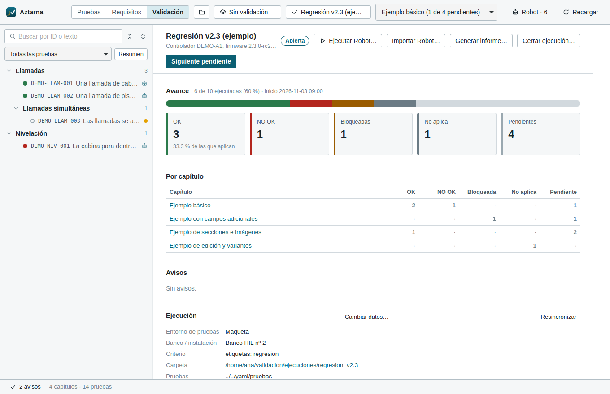

Se ve al abrir la ejecución, al pulsar **Resumen** o cuando no hay ninguna
prueba seleccionada:

- avance y totales por resultado;
- desglose por capítulo: haz clic en un capítulo para ir a él (se abre su
  primera prueba pendiente);
- **avisos**: pruebas NO OK o bloqueadas sin observaciones, pruebas que
  cambiaron después de ejecutarse, pruebas que ya no existen (haz clic para
  ir a ellas);
- botones **Ejecutar Robot…** e **Importar Robot…** (ver 6.7), **Generar
  informe…**, **Cerrar ejecución…** y **Siguiente pendiente**;
- en el apartado **Ejecución**, su entorno de pruebas y sus datos; **Cambiar
  datos…** los corrige mientras está abierta;
- **Comparar con…**: elige otra ejecución (normalmente la anterior del mismo
  entorno) y verás los **nuevos fallos** (NO OK ahora y no antes), las
  **arregladas** (NO OK antes y bien ahora), las que siguen fallando y los
  demás cambios.

Si la ejecución forma parte de una validación abierta, arriba aparece un
botón para **volver a la validación**.

### 6.5 Pasar una prueba

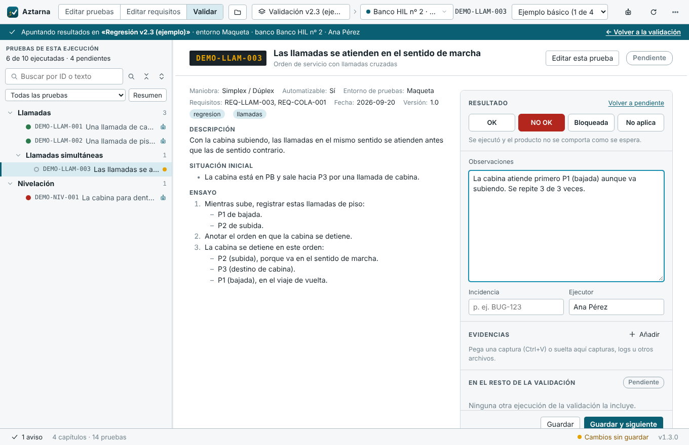

El árbol muestra solo las pruebas de la ejecución, con un punto de color según
su resultado (vacío = pendiente). El desplegable de encima filtra (por
ejemplo, *Pendientes* o *NO OK*) y el selector de capítulo indica cuántas
quedan en cada uno.

Un **triángulo de aviso** junto a una prueba indica que se editó después de
ejecutarse (al pasar el ratón se ve en qué entorno o ejecución). La opción
*Cambiadas tras ejecutarse* del desplegable deja solo esas pruebas, para
decidir cuáles repetir.

A la izquierda está la prueba en solo lectura, compacta para ver de una un
ensayo de 20 o 30 pasos (sus datos en una línea arriba); a la derecha, su
resultado. Los cuatro resultados van en una fila y las **observaciones**
ocupan el resto del panel (también se pueden estirar por la esquina):

1. Elige el resultado con los botones o con las teclas **1 a 4**.
2. Escribe las **observaciones** (necesarias en NO OK y Bloqueada), la
   **incidencia** (por ejemplo `BUG-123`) y comprueba el **ejecutor** (se
   recuerda para la próxima vez).
3. Añade **evidencias**: pega una captura con **Ctrl+V**, suelta archivos en
   el panel o pulsa **Añadir**. Se admiten imágenes y también logs u otros
   archivos (se abren con su programa al hacer clic).
4. **Guardar y siguiente** (**Ctrl+Intro**) guarda y salta a la siguiente
   prueba pendiente. **Guardar** (**Ctrl+S**) guarda sin moverse.

Si una prueba se editó después de ejecutarla, el panel avisa por si hay que
repetirla. *Volver a pendiente* deshace el último resultado.

### 6.6 Repetir una prueba

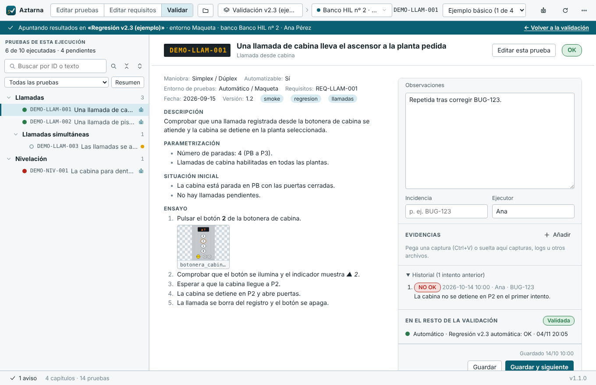

Si una prueba falla, se corrige y se vuelve a pasar, apunta el nuevo
resultado normalmente. El anterior **no se pierde**: queda en el
**Historial** con sus observaciones, incidencia y evidencias, y aparecerá en
el informe («NO OK con BUG-123; OK tras corregirlo»).

### 6.7 Pruebas automáticas (Robot Framework)

Si parte de las pruebas se ejecutan con Robot Framework, sus resultados se
pueden apuntar de golpe:

1. Ejecuta Robot como siempre. Al terminar deja un archivo `output.xml`.
2. En el resumen de la ejecución pulsa **Importar Robot…** y elige ese
   `output.xml`.
3. Antes de cambiar nada verás qué resultado tendrá cada prueba (PASS → OK,
   FAIL → NO OK con el motivo, SKIP → No aplica) y los avisos: pruebas que ya
   tenían un resultado manual (no se pierde: pasa al historial), tests de
   Robot sin enlazar o con un ID que no existe, y pruebas de la ejecución que
   no tienen test automático (esas se pasan a mano como siempre).
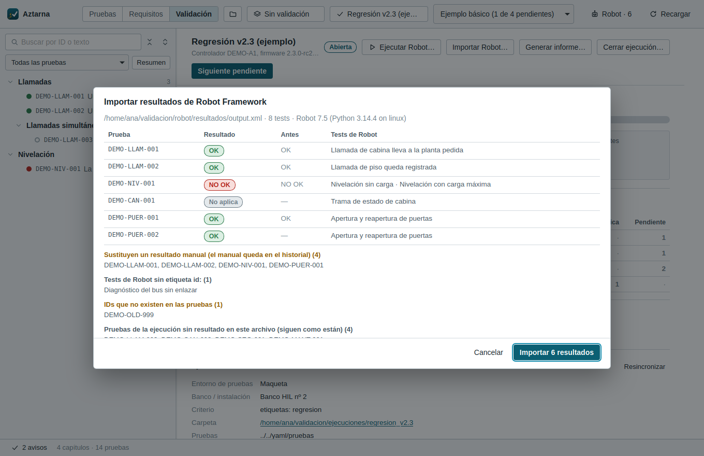

4. Pulsa **Importar**. El log de Robot y sus capturas quedan como evidencias
   de cada prueba, y el panel indica *Resultado importado de Robot
   Framework*.

Para que una prueba reciba el resultado, su test de Robot tiene que llevar la
etiqueta `id:` con el ID de la prueba (por ejemplo `id:DEMO-LLAM-001`). Quien
escribe los tests de Robot tiene los detalles en el
[apartado 10](#10-robot-framework-guía-para-quien-escribe-los-tests).

**Configurar Robot.** El botón **Robot** de la barra superior indica dónde
están los tests de Robot de este PC y cómo se ejecuta Robot (el comando que
usarías en la consola; *Comprobar* verifica que funciona). Se configura una
vez por PC y carpeta de pruebas. Si las librerías de keywords (Python o
`.resource`) están fuera de la carpeta de tests, añádelas en *Otras carpetas
con keywords* para que se propongan al escribir los pasos.

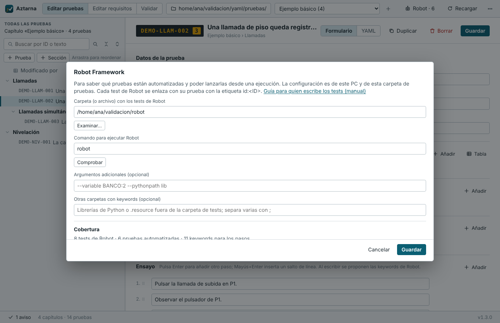

Con eso, el editor sabe qué pruebas están automatizadas: las marca con un
robot en el árbol, cada prueba muestra sus tests de Robot, la validación
avisa de las pruebas marcadas como automatizable «hecho» que no tienen test,
y al crear una ejecución se puede filtrar por *Automatización: con / sin test
de Robot*.

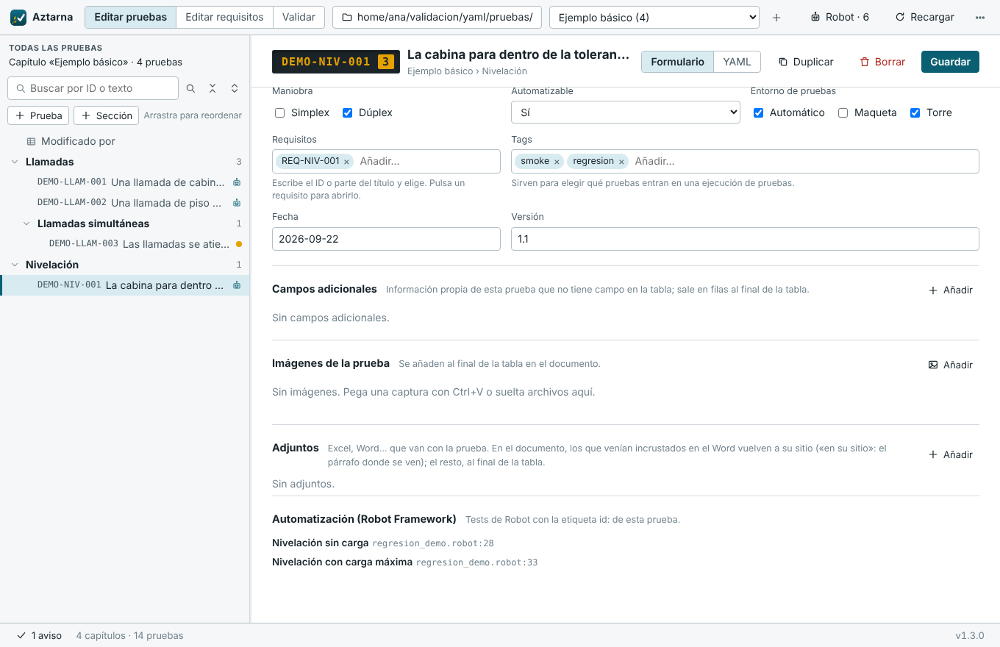

**Ejecutar Robot desde la ejecución.** En el resumen, **Ejecutar Robot…** lanza
Robot solo con las pruebas de la ejecución que tienen test automático (las
pendientes o todas). Se ve el avance test a test y se puede cancelar; al
terminar aparece la misma vista previa de la importación.

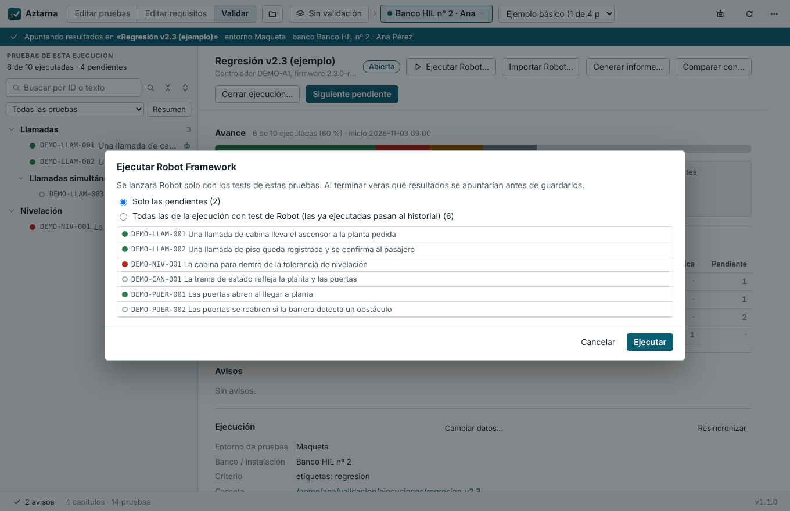

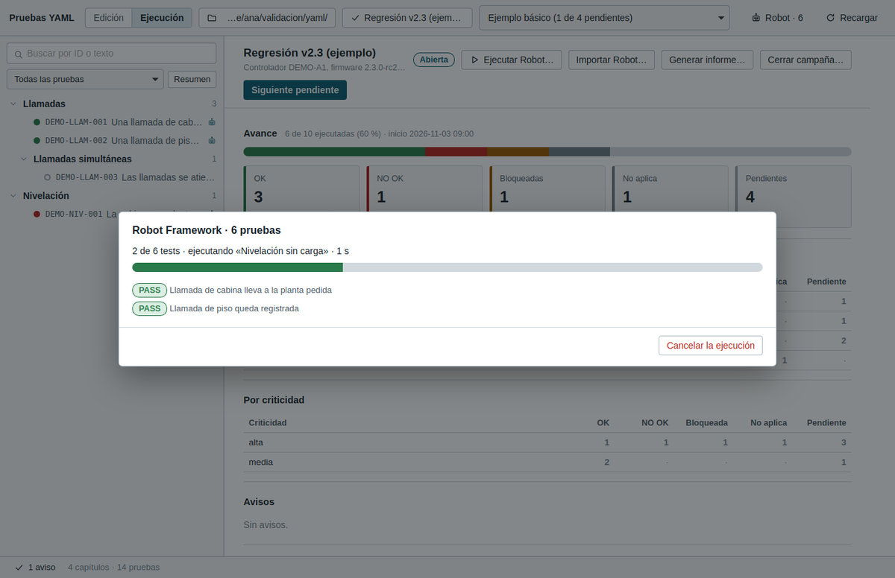

### 6.8 Cerrar la ejecución

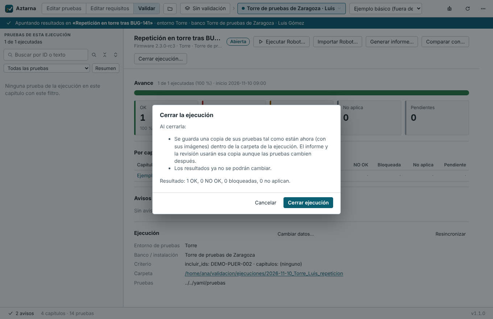

Cuando no quede ninguna pendiente (ejecútalas o márcalas como *No aplica*),
pulsa **Cerrar ejecución…**. Al cerrarla:

- se guarda dentro de la ejecución una **copia de sus pruebas tal como están**,
  con sus imágenes. El informe y la revisión usarán siempre esa copia aunque
  las pruebas cambien después;
- los resultados ya **no se pueden cambiar**.

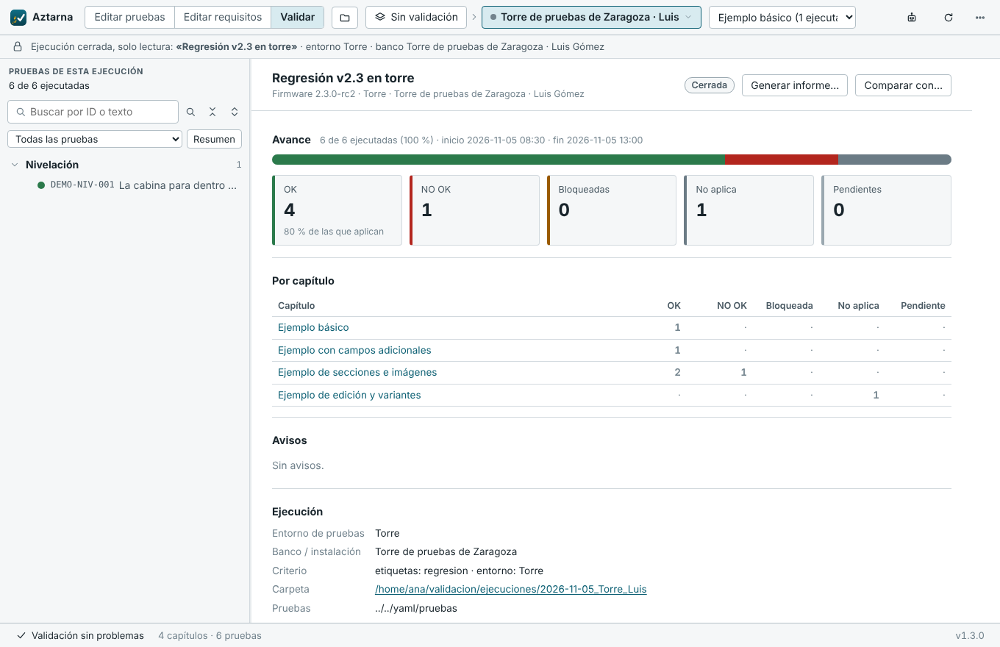

Una ejecución cerrada se sigue pudiendo abrir para consultarla. La barra
superior indica *Pruebas congeladas (solo lectura)*: para volver a editar las
pruebas, abre su carpeta de pruebas con el botón de la carpeta.

### 6.9 Informe de la ejecución

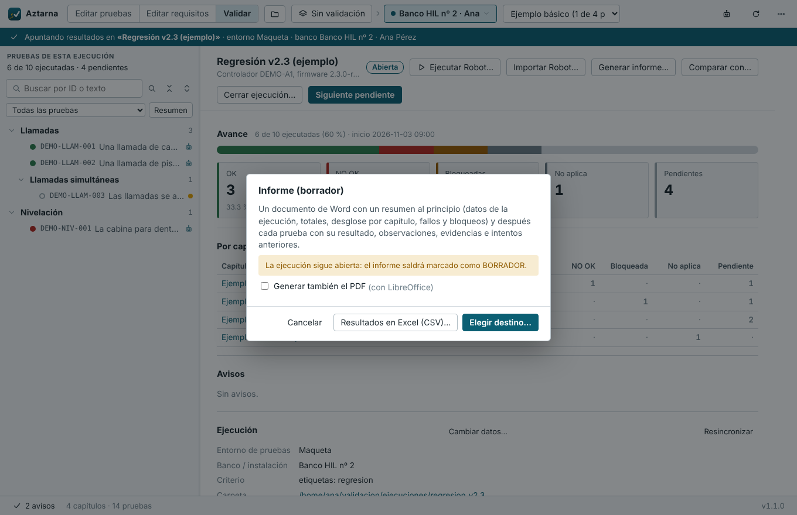

**Generar informe…** crea un documento de Word, y opcionalmente un **PDF**
(hace falta tener instalado LibreOffice o Microsoft Word). Con la ejecución
todavía abierta, el informe sale marcado como **BORRADOR**. Mientras se
genera verás una ruleta; el PDF es lo que más tarda.

| Primera página: resumen | Cada prueba con su resultado |
|---|---|
| 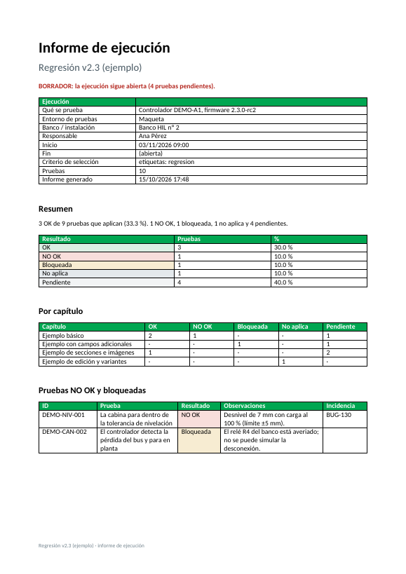 | 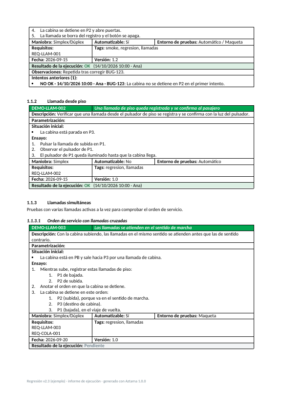 |

El informe empieza con los datos de la ejecución, el criterio de selección, los
totales, el desglose por capítulo y la lista de pruebas NO OK y bloqueadas.
Después vienen las pruebas con el mismo aspecto que el documento de pruebas
y, debajo de cada tabla, el resultado en color con fecha y ejecutor,
observaciones, incidencia, evidencias e intentos anteriores.

### 6.10 La validación de una versión

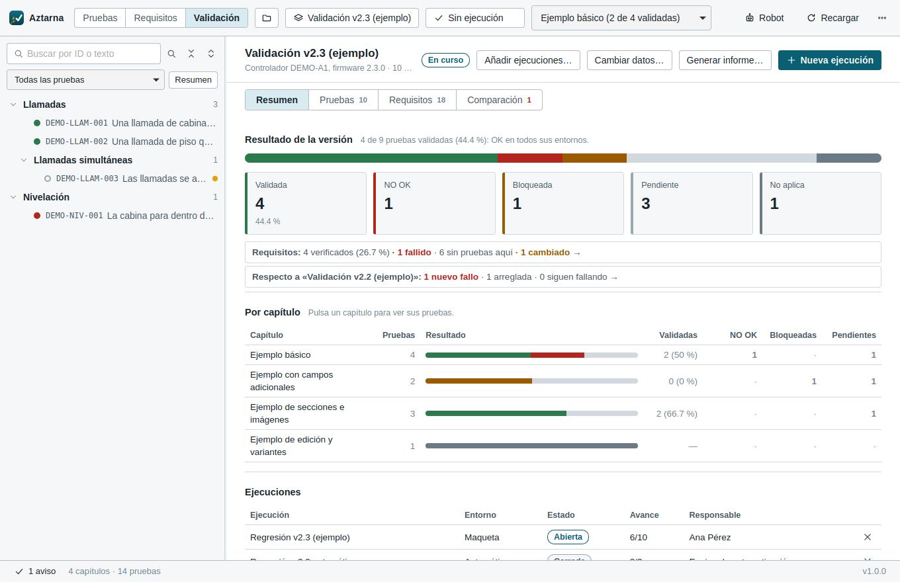

**Crear la validación.** Botón de la validación (el de las capas, en la barra
superior) → **Nueva validación…**: nombre, versión y **qué pruebas hay que
pasar** (las mismas fichas que al crear una ejecución). Después eliges dónde
guardarla.

**Añadir las ejecuciones.** **Añadir ejecuciones…** y elige la carpeta de una
ejecución o una carpeta que contenga varias (por ejemplo, la compartida donde
cada persona deja las suyas): se añaden todas las que haya. La validación no
copia las ejecuciones, apunta a ellas, así que conviene dejarlas en un sitio
fijo. **Nueva ejecución** crea una dentro de la carpeta de la validación,
partiendo de su criterio. La **×** de cada fila la quita de la validación (no
la borra). Los resultados de una ejecución hecha fuera del editor, en un
Word, se importan como una ejecución nueva (ver 7.5).

Si abres por tu cuenta una ejecución que no forma parte de la validación
abierta, su resumen lo avisa (sus resultados no cuentan) y ofrece
**Añadirla a la validación**.

**Cómo se calcula el resultado.** Cada prueba indica en su campo *Entorno de
pruebas* dónde hay que pasarla, y cada ejecución en qué entorno se hizo:

- en cada entorno cuenta el resultado **más reciente** de las ejecuciones de
  ese entorno (los anteriores quedan como historial);
- una prueba queda **validada** cuando está OK (o No aplica) en **todos** sus
  entornos; **NO OK** si falla en alguno; **bloqueada** si alguno no se pudo
  ejecutar; **pendiente** si falta alguno;
- un resultado en un entorno que la prueba no pide **se muestra, pero no
  cuenta** (en gris); si es un NO OK, se avisa;
- una prueba sin entorno indicado vale en cualquiera, con un aviso para
  completarla.

El panel tiene cuatro pestañas:

- **Resumen**: el resultado de la versión, una línea con los requisitos y otra
  con la comparación con la anterior (llevan a su pestaña), una tabla **por
  capítulo** (pulsa uno para ver sus pruebas), las ejecuciones (pulsa una para
  abrirla), la tabla **por entorno** (*Sin planificar*: ninguna ejecución de
  ese entorno incluye la prueba) y los avisos. Las cifras de arriba llevan a
  la pestaña *Pruebas* con ese filtro (también en el árbol).
- **Pruebas**: la tabla **prueba × entorno** agrupada por capítulos, cada uno
  con su barra y su porcentaje de validadas. Pulsa un capítulo para
  desplegarlo; *Desplegar todo* / *Plegar todo*; buscador por ID o título y
  filtro por resultado. Con pocas filas (o mientras buscas) sale todo
  desplegado.
- **Requisitos** y **Comparación**: ver abajo.

La pestaña elegida se recuerda.

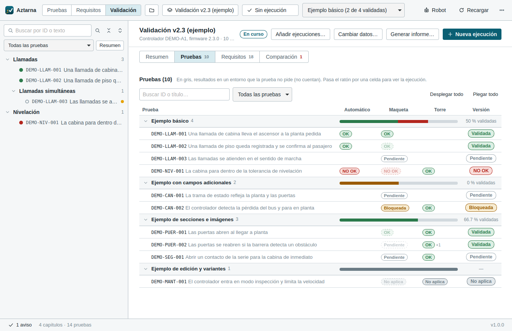

Con muchas pruebas, los capítulos salen plegados y se ve de un vistazo cuáles
van peor:

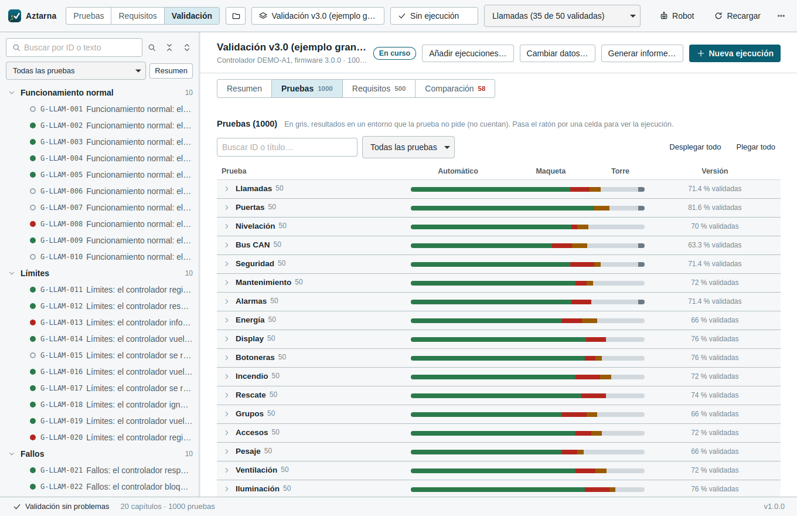

Al pulsar una prueba se ve su ficha con el resultado en cada entorno y su
historial; el nombre de cada ejecución lleva a esa prueba dentro de ella para
apuntar o corregir el resultado.

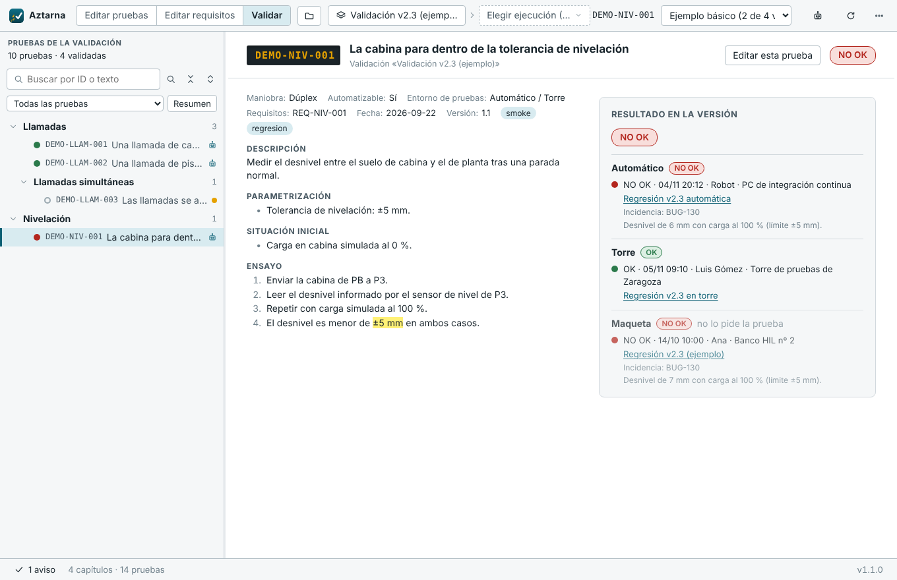

**Requisitos de la versión.** Si el proyecto tiene requisitos, la pestaña
**Requisitos** dice cuáles quedan verificados con esta validación:

- **verificado**: todas las pruebas de la validación que lo citan están
  validadas; **fallido** si alguna es NO OK; **bloqueado** o **pendiente** si
  alguna lo está;
- **sin pruebas aquí**: necesita pruebas, pero ninguna de esta validación lo
  cita; **no aplica**: no se valida con pruebas (por ejemplo, por
  inspección).

Va agrupada por capítulos de requisitos, como la de pruebas; las tarjetas
filtran y cada prueba se puede pulsar. Si algún requisito **ha cambiado**
desde la última revisión de sus pruebas, lo avisa y **Ejecución de
impacto…** crea una ejecución dentro de la validación con solo esas pruebas.

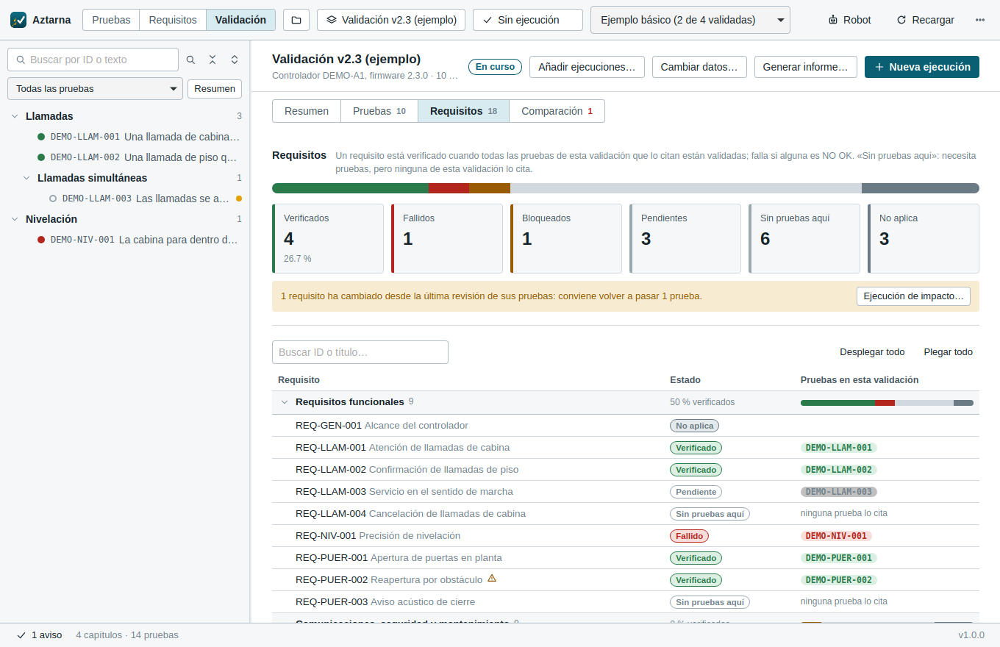

**Comparar con la versión anterior.** En la pestaña **Comparación**, *Comparar
con otra validación…* elige la validación de la versión anterior (se
recuerda). Verás:

- la **evolución**: una fila por versión con su resultado, siguiendo la
  cadena de «comparar con» (la v2.3 con la v2.2, la v2.2 con la v2.1…);
- los **cambios** por capítulo: **nuevos fallos** (NO OK ahora y no antes),
  **arregladas** (NO OK antes y bien ahora), **siguen fallando**, otros
  cambios, pruebas nuevas y las que ya no están. Las tarjetas filtran.

La pestaña indica en rojo cuántos nuevos fallos hay. *Quitar* deja de
comparar.

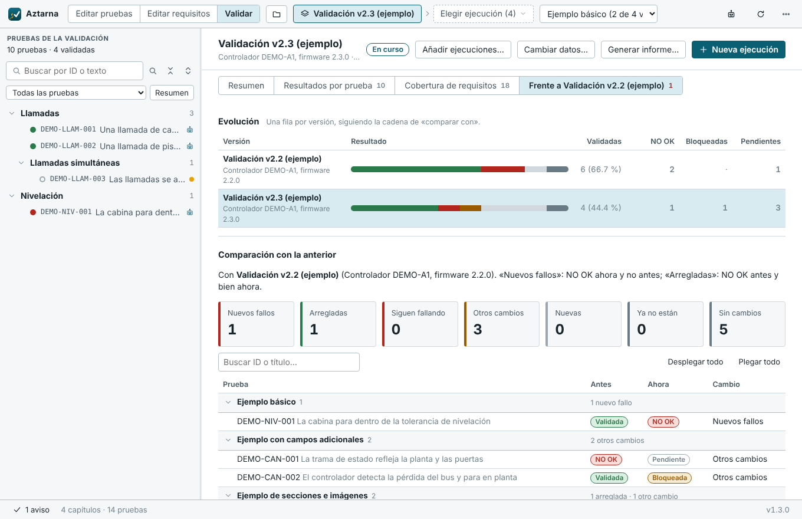

**Informe de la validación.** **Generar informe…** crea un Word apaisado (y,
si quieres, el PDF) en dos partes:

- **resumen**: datos de la versión, ejecuciones, resultado por entorno y
  **por capítulo**, la comparación con la anterior (con la evolución) y los
  requisitos, también por capítulo;
- **detalle por capítulo**: las pruebas no validadas con sus observaciones,
  la tabla prueba × entorno en color y cada requisito con sus pruebas, con un
  título por capítulo.

Quita *Incluir el detalle por capítulos* para sacar solo el resumen (útil con
muchas pruebas). Mientras quede alguna ejecución abierta sale como
**BORRADOR**. Los pasos de cada prueba están en el informe de cada ejecución.

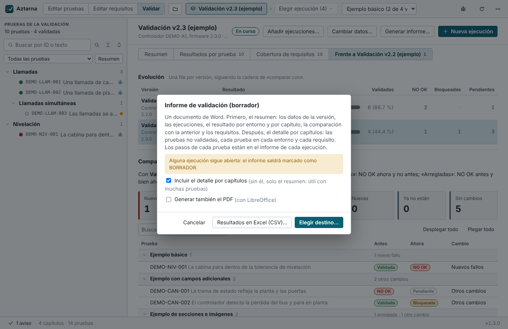

**Resultados en Excel.** En el mismo diálogo, **Resultados en Excel (CSV)…**
guarda una fila por prueba con su resultado en cada entorno, la ejecución,
la fecha, el ejecutor, las observaciones y la incidencia. Se abre con Excel
(en una ejecución sale el mismo botón en su informe).

**Trabajar sin validación.** Botón de la validación → **Trabajar sin
validación**: el modo vuelve a funcionar solo con ejecuciones sueltas.

En los ejemplos hay una validación completa:
`ejemplos/validaciones/validacion_v2.3`, que une cuatro ejecuciones de
`ejemplos/ejecuciones/` (Robot, torre, una repetición en torre y maqueta) y se
compara con `validacion_v2.2`. Para ver cómo se comporta con un proyecto de
tamaño real, `ejemplos/grande` tiene 1000 pruebas, 500 requisitos y dos
validaciones (abre la carpeta `ejemplos/grande` y la validación
`validaciones/v3.0`).

**¿Los resultados van en Git?** Las pruebas y los requisitos, sí (es lo que
se edita y se revisa). Las ejecuciones y las validaciones, mejor no: son
registros de lo que pasó (con capturas y logs que pesan) y cada persona hace
las suyas. Déjalas en una carpeta compartida de la red y, al cerrar una
versión, archiva su validación con el informe.

---

## 7. Importar desde Word

**⋯ → Importar desde Word…** trae al proyecto las pruebas o los requisitos de
un documento de Word, o los resultados de una ejecución. El editor no cambia
nada hasta el último paso, y recuerda lo que eliges para la próxima vez.

Se espera la forma de las plantillas: la primera fila de cada tabla es
«**ID** | **Título**» y cada celda de las demás empieza por «**Etiqueta:**
valor» («Descripción: …», «Fuente: …»). Un párrafo «Etiqueta:» solo en su
línea abre otro campo dentro de la misma celda («Situación inicial:» y
«Ensayo:»). Los títulos del Word (Título 1, 2, 3…) dan los capítulos y las
secciones.

### 7.1 Documento

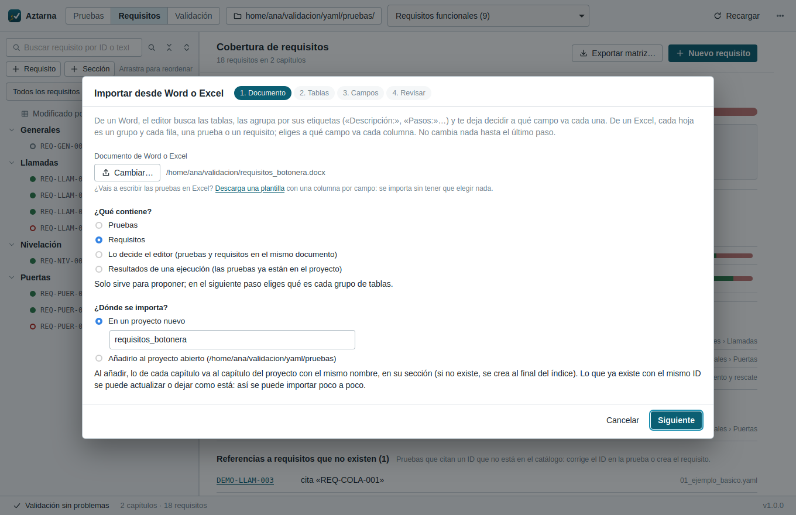

Elige el Word, **qué contiene** (pruebas, requisitos, los dos, o resultados;
solo sirve para proponer) y **dónde se importa**: en un **proyecto nuevo**
(una carpeta con `pruebas/` y `requisitos/`; nada de lo que ya tienes se toca)
o **añadido al proyecto abierto** (sus capítulos van al final del índice).

Con documentos grandes cada paso puede tardar un poco: la ventana se pone gris
con un mensaje y el tiempo que lleva.

### 7.2 Tablas

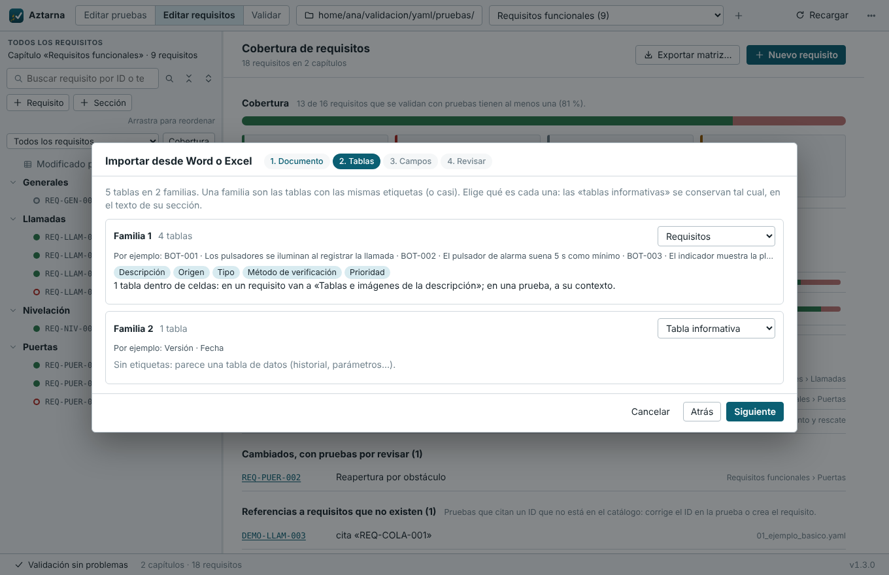

El editor agrupa las tablas en **familias**: las que tienen las mismas
etiquetas (o casi). Para cada una eliges qué es: **pruebas**, **requisitos**,
**tabla informativa** (se conserva tal cual, en el texto de su sección, como
un historial de cambios) o **no importar**. Las tablas dentro de una celda se
conservan: en un requisito, en *Tablas e imágenes de la descripción*; en una
prueba, en su contexto.

### 7.3 Campos

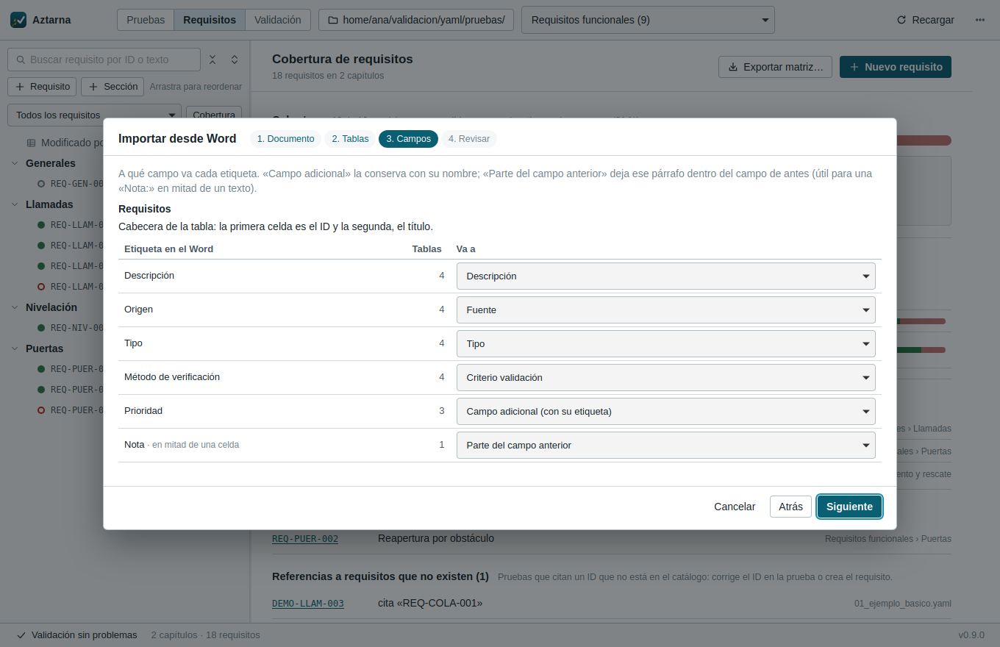

Cada etiqueta del Word, con cuántas tablas la tienen y a qué campo va. El
editor propone las evidentes («Origen» → *Fuente*, «Método de verificación» →
*Criterio validación*, «Pasos» → *Ensayo*); cámbialas donde no acierte.
Además de los campos hay tres opciones:

- **Campo adicional**: se conserva con su nombre (en *Campos adicionales*).
- **Parte del campo anterior**: el párrafo se queda dentro del campo de antes;
  sirve para una «Nota:» en mitad de una descripción.
- **No importar**.

### 7.4 Revisar e importar

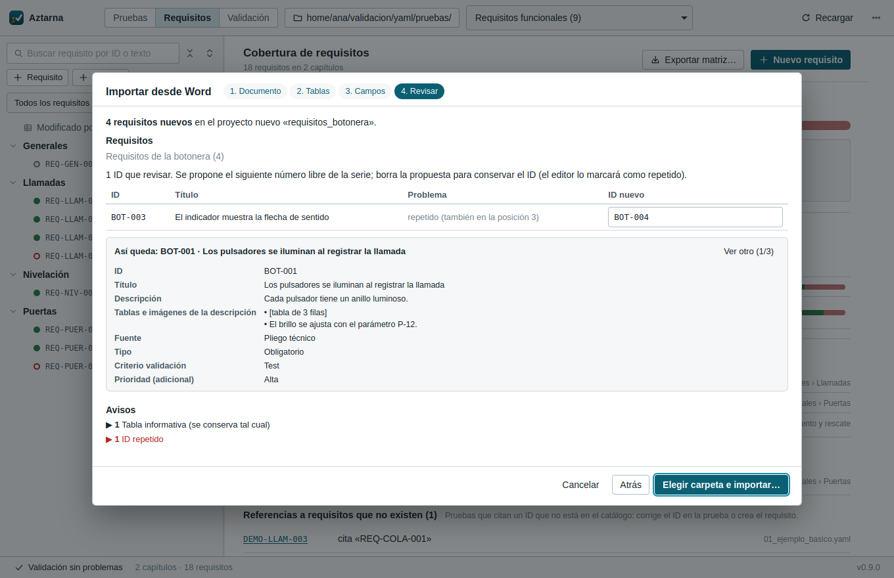

Antes de importar ves cuántos elementos entran y en qué capítulos, un
**ejemplo** de cómo queda cada uno (*Ver otro*), los **IDs que revisar**
(repetidos o vacíos, con el siguiente número libre de la serie propuesto;
borra la propuesta para conservar el ID) y los **avisos**: por ejemplo, texto
del Word que no ha llegado a ningún campo. En un proyecto nuevo, **Elegir
carpeta e importar…** pide dónde crearlo y lo abre.

**Volver a importar un Word en el proyecto abierto.** Si el Word trae IDs que
ya existen, aparece el bloque **Ya existen en el proyecto** con lo que cambia
en cada uno y qué hacer:


- **Actualizar el del proyecto**: sus campos pasan a ser los del Word; conserva
  su sitio en el árbol, su nivel y su encabezado. Si un requisito actualizado
  tiene pruebas, queda *cambiado, con pruebas por revisar* (ver 5.4), y una
  prueba ya ejecutada lo mostrará en las ejecuciones.
- **Importar como nuevo**, con el ID nuevo que escribas.
- **No importar**.

Por defecto se actualizan los que cambian y no se tocan los que están igual;
*Para todos…* aplica lo mismo a todos.

### 7.5 Resultados de una ejecución

Para un Word con las tablas de las pruebas y unas filas más con el resultado
(«Resultado obtenido: Correcto», «Observaciones: …», «Ejecutor: …», «Fecha
ejecución: …»). Las pruebas tienen que estar ya en el proyecto: los
resultados se enlazan por el ID de la cabecera de cada tabla.

En **Campos** se indica qué etiqueta es el **Resultado**, las
**Observaciones**, la **Incidencia**, el **Ejecutor** y la **Fecha de
ejecución** (las de la propia prueba quedan como *No importar*), y debajo,
**qué resultado es cada valor** escrito en el Word:


Un valor que no es ningún resultado deja la prueba pendiente y su texto pasa a
las observaciones. En **Revisar** ves las cifras, los avisos (pruebas que no
están en el proyecto, fechas que no se entienden…) y los datos de la
ejecución que se crea: nombre, **entorno de pruebas** (obligatorio), qué se
prueba, banco y responsable. Con una validación abierta, se puede crear
**dentro de ella**.


La ejecución queda **abierta** con esas pruebas y sus resultados (con su fecha
y quién la ejecutó): revísala, completa las pendientes y ciérrala.

---

## 8. Atajos de teclado

| Atajo | Dónde | Hace |
|---|---|---|
| Ctrl+S | Siempre | Guardar |
| Ctrl+F | Siempre | Ir al buscador |
| Ctrl+Mayús+F | Siempre | Buscar (y reemplazar) en todos los capítulos |
| Ctrl + rueda, Ctrl+ / Ctrl− | Siempre | Más grande / más pequeño |
| Ctrl+0 | Siempre | Tamaño normal |
| ↑ / ↓ | Árbol | Prueba anterior / siguiente |
| ← / → | Árbol | Plegar / desplegar sección |
| Ctrl+clic / Mayús+clic | Árbol | Elegir varios (uno a uno / un rango) |
| Alt+← / Alt+→ | Árbol | Subir / bajar de nivel lo elegido |
| Esc | Árbol | Quitar la selección de varios |
| Ctrl+B / Ctrl+I | Texto | Negrita / cursiva |
| Ctrl+Z / Ctrl+Y | Texto | Deshacer / rehacer |
| Intro / Mayús+Intro | Lista | Fila nueva / salto de línea |
| ↑ / ↓, Intro o Tab, Esc | Lista de keywords | Moverse, elegir, cerrar |
| Retroceso | Fila vacía | Borrar la fila |
| Alt+↑ / Alt+↓ | Lista | Mover la fila |
| Ctrl+V | Lista o evidencias | Pegar una captura |
| 1, 2, 3, 4, 0 | Validación (una prueba) | OK, NO OK, Bloqueada, No aplica, Pendiente |
| Ctrl+Intro | Validación (una prueba) | Guardar y siguiente pendiente |

---

## 9. Preguntas frecuentes y problemas

**¿Dónde se guarda lo que hago?**
Las pruebas, en su carpeta de pruebas (un archivo por capítulo, y las
imágenes en `imagenes/`); los requisitos, en la carpeta `requisitos`, junto
a la de pruebas. Las ejecuciones, en la carpeta que elegiste al crearlas
(`ejecucion.yaml`, `resultados.yaml`, `evidencias/` y, al cerrarla,
`pruebas_congeladas/`). Las validaciones, en la suya (`validacion.yaml`, que
solo apunta a sus ejecuciones). El editor no guarda nada en otro sitio.

**¿De dónde salen las opciones de Maniobra y Entorno?**
Del archivo `aztarna.yaml` de la carpeta del proyecto (junto a `pruebas` y
`requisitos`; en una carpeta de pruebas suelta, dentro de ella). Lo prepara
quien mantiene el proyecto y vale para todos los que lo abren:

```yaml
opciones:
  maniobra: [Simplex, Dúplex]
  entorno: [Automático, Maqueta, Torre]
equivalencias:            # otras formas de escribirlas en un Word que se importa
  maniobra: {S: Simplex, D: Dúplex}
```

Sin ese archivo, Maniobra no tiene opciones y Entorno usa Automático, Maqueta
y Torre. Después de cambiarlo, pulsa **Recargar**. Al cerrar una ejecución se
guarda una copia con sus pruebas congeladas.

**«… está editando … : no se ha guardado».**
Otra persona tenía el capítulo reservado cuando guardaste (ver «Varias
personas en la misma carpeta», en 2). Copia lo que hayas escrito, espera a que
lo deje (o pulsa **Comprobar de nuevo**) y repite el cambio.

**«… se guardó con una versión más nueva del programa».**
La carpeta (o la ejecución, o la validación) la guardó alguien con una versión
del programa que guarda los datos de otra forma. Tu copia la deja ver, pero no
guardar, para no estropearla: copia la versión nueva del programa.

**«… ha cambiado en el disco desde que se cargó».**
Otra persona o programa modificó el archivo mientras lo tenías abierto. El
editor lo vuelve a leer para no pisar esos cambios: revisa la prueba y repite
tu cambio.

**«El ID … ya existe».**
Cada prueba (y cada requisito) necesita un ID distinto. Usa otro (por
ejemplo, el siguiente número libre).

**¿Dónde se apunta qué pruebas hay que revisar por un requisito cambiado?**
En `requisitos/revisiones.yaml`, que escribe el editor. Guarda el texto que
tenía cada requisito cambiado en su última revisión; al pulsar **Pruebas
revisadas** se quita su entrada.

**Una imagen dice «Sin vista previa».**
Las imágenes EMF (diagramas de Word) no tienen miniatura fuera de Windows,
pero se conservan y salen bien en el documento y en el informe.

**Una ejecución dice que no indica su entorno de pruebas.**
Sus resultados no cuentan en ninguna validación hasta que lo indiques: ábrela
y pulsa **Cambiar datos…** (en el apartado *Ejecución* del resumen).

**No me deja crear la ejecución.**
O ninguna prueba cumple el criterio elegido, o hay IDs repetidos o vacíos
(revisa la validación en el modo Pruebas).

**No me deja cerrar la ejecución.**
Quedan pruebas pendientes. Ejecútalas o márcalas como *No aplica*.

**La opción de PDF no está disponible.**
Instala LibreOffice (o, en Windows, Microsoft Word). El documento de Word se
genera igualmente.

**Al importar, una prueba o un requisito sale en un nivel que no es.**
Con varios elegidos en el árbol (Ctrl+clic o Mayús+clic) súbelos o bájalos de
nivel a la vez (ver 4.5). Si pasa en todo un documento, revisa en el Word que
los títulos usen los estilos de título (Título 1, 2, 3…) o un estilo basado
en ellos.

**¿Qué versión del editor tengo?**
La de la esquina inferior derecha (o **⋯ → Acerca de…**). Las novedades de
cada versión están en `CHANGELOG.md`.

**No puedo editar las pruebas.**
Probablemente estás viendo las *pruebas congeladas* de una ejecución cerrada
(lo indica la barra superior). Abre la carpeta de pruebas con el botón de la
carpeta.

**El editor no arranca en Windows.**
Necesita *WebView2*, que viene con Windows 11 y con Windows 10 actualizado.
Si falta, instálalo desde la web de Microsoft («WebView2 Runtime»).

**En Ubuntu aparece un aviso de error del sistema al cerrar.**
Es un fallo conocido de un componente de Ubuntu (WebKitGTK) al apagarse,
cuando el editor ya ha terminado. No se pierde nada.

**Buenas costumbres**

- No cambies el ID de una prueba que ya se ha pasado en alguna ejecución.
- Usa siempre las mismas etiquetas (mejor elegirlas de las que propone).
- Escribe observaciones en todo NO OK y Bloqueada: es lo que leerá quien
  reciba el informe.
- Haz copia de seguridad de la carpeta de pruebas antes de cambios grandes.

---

## 10. Robot Framework: guía para quien escribe los tests

Detalles para quien escribe y mantiene los tests de Robot Framework. Para
importar o lanzar Robot desde una ejecución basta con el apartado
[6.7](#67-pruebas-automáticas-robot-framework).

Cómo enlazar los tests automáticos de Robot Framework con las pruebas del
editor para que sus resultados entren en las ejecuciones.

### 10.1 La convención: la etiqueta `id:`

Cada test de Robot lleva la etiqueta `id:` seguida del **ID de la prueba
YAML** que automatiza:

```robotframework
*** Test Cases ***
Llamada de cabina lleva a la planta pedida
    [Tags]    id:DEMO-LLAM-001    regresion
    ${planta}=    Simular Viaje    origen=0    destino=2
    Should Be Equal As Integers    ${planta}    2
```

- **Es el único enlace.** El nombre del test de Robot, su suite o su archivo
  pueden cambiar sin romper nada; el ID no (igual que en el editor).
- **Un test puede cubrir varias pruebas:** pon varias etiquetas
  (`[Tags]  id:DEMO-PUER-001  id:DEMO-PUER-002`).
- **Varios tests pueden cubrir la misma prueba** (variantes, datos
  distintos): todos llevan la misma etiqueta `id:`.
- Las demás etiquetas (`regresion`, `smoke`…) se pueden seguir usando como
  siempre; el importador solo mira las que empiezan por `id:`.
- Las mayúsculas del prefijo dan igual (`ID:` también vale); el ID se copia
  tal cual, así que debe coincidir exactamente con el de la prueba YAML.

Para etiquetar muchos tests de una suite a la vez puede usarse `Test Tags`
en *Settings* (`Force Tags` en versiones antiguas de Robot), pero lo normal
es una etiqueta por test.

### 10.2 Cómo se convierte cada resultado

| Robot | Ejecución |
|---|---|
| PASS | OK |
| FAIL | NO OK (el mensaje de error va a *Observaciones*) |
| SKIP | No aplica (el motivo va a *Observaciones*) |
| NOT RUN | No se importa (la prueba sigue como estaba) |

Si varios tests de Robot cubren la misma prueba: si **alguno falla**, NO OK;
si no, si **alguno pasa**, OK; si **todos se saltan**, No aplica. Las
observaciones indican qué tests se ejecutaron y por qué falló cada uno.

### 10.3 Importar los resultados

1. Ejecuta Robot como siempre; deja un `output.xml` (por defecto, junto a
   `log.html` y `report.html`):

   ```bash
   robot --outputdir resultados pruebas_robot/
   ```

2. En el editor, modo **Validación**, abre la ejecución y pulsa **Importar
   Robot…** en el resumen. Elige el `output.xml`. Antes de cambiar nada verás
   qué resultado tendrá cada prueba y los avisos:
   - pruebas que ya tenían un resultado manual (el manual no se pierde: queda
     en el historial),
   - tests de Robot sin etiqueta `id:`,
   - IDs que no existen en las pruebas (erratas o pruebas borradas),
   - IDs que existen pero no están en esta ejecución,
   - pruebas de la ejecución sin resultado en ese archivo (se quedan como
     están, para pasarlas a mano o en otra ejecución).
3. Pulsa **Importar**. Se copian `output.xml`, `log.html`, `report.html` y
   las capturas enlazadas en el log a `evidencias/robot/<fecha>/` dentro de la
   ejecución, y cada prueba queda con su resultado, el ejecutor «Robot
   Framework», la captura y el `log.html` como evidencias.

También desde la línea de comandos (útil en un PC sin el editor abierto o,
más adelante, en integración continua):

```bash
python herramientas.py robot ruta/a/la/ejecución resultados/output.xml --simular   # solo mira
python herramientas.py robot ruta/a/la/ejecución resultados/output.xml             # importa
```

Volver a importar el mismo `output.xml` no duplica nada. Si se repiten los
tests fallidos (`robot --rerunfailed resultados/output.xml …`) y se importa
el nuevo resultado, el anterior queda en el historial de cada prueba.

### 10.4 Configurar Robot en el editor

Botón **Robot** de la barra superior. La configuración es de cada PC y de
cada carpeta de pruebas:

- **Carpeta con los tests de Robot:** la carpeta de las suites (o un archivo
  `.robot`).
- **Comando para ejecutar Robot:** el que usarías en la consola, por ejemplo
  `robot`, `python -m robot` o la ruta completa
  (`C:\venv\Scripts\robot.exe`). *Comprobar* ejecuta `--version`.
- **Argumentos adicionales:** los que necesite el banco, por ejemplo
  `--variable BANCO:2 --pythonpath lib`.

Robot se ejecuta en la carpeta de los tests, con el Python donde esté
instalado; el editor no necesita tenerlo instalado.

### 10.5 Cobertura: qué pruebas tienen test de Robot

Con la carpeta configurada, el editor lee las etiquetas `id:` de los `.robot`
(sin ejecutarlos; tiene en cuenta `Test Tags`/`Force Tags` del archivo y de
`__init__.robot`) y:

- marca con un robot en el árbol las pruebas que tienen test automático, y
  en cada prueba lista sus tests de Robot (archivo y línea);
- avisa en la validación de las pruebas con `automatizable: hecho` sin test
  de Robot;
- en la configuración muestra los tests sin `id:` y los `id:` que no existen;
- al crear una ejecución permite filtrar por **Automatización: con / sin test
  de Robot**.

### 10.6 Escribir los pasos con las keywords

Para que las pruebas nuevas se escriban igual que los tests de Robot, el
editor propone las keywords existentes al escribir *Situación inicial*,
*Pasos* y *Situación final*, y marca con un robot los pasos que ya son una
keyword.

De dónde salen (sin ejecutar nada, leyendo los archivos):

- la sección *Keywords* de los `.robot` y `.resource` de la carpeta de tests
  (con `[Arguments]` y la primera línea de `[Documentation]`);
- las librerías de Python: las funciones decoradas con `@keyword` y, si algún
  `.robot` o `.resource` importa el archivo con `Library`, sus funciones
  públicas (o los métodos de la clase que se llama como el archivo). Se
  respetan `ROBOT_AUTO_KEYWORDS = False`, `@library` y `@not_keyword`;
- **Otras carpetas con keywords** (en la configuración de Robot): librerías o
  `.resource` que no están dentro de la carpeta de tests. Varias, separadas
  por `;`.

Las más usadas en los tests aparecen primero. Al elegir una, el paso se
escribe con la sintaxis de Robot:

| Keyword | Paso escrito |
|---|---|
| `Registrar una llamada de piso en ${planta}` (argumento incrustado) | `Registrar una llamada de piso en ${planta}` con `${planta}` seleccionado para escribir el valor |
| `Comprobar la alarma` con `[Arguments]  ${codigo}  ${timeout}=5 s` | `Comprobar la alarma    codigo=` (solo los obligatorios, con nombre) |

Un paso se considera keyword si su primera celda (hasta dos espacios
seguidos) coincide con el nombre como lo compara Robot (sin mayúsculas,
espacios ni guiones bajos), ignorando un punto final y los prefijos
*Given/When/Then/And/But*; las keywords con argumentos incrustados se
reconocen con cualquier valor (`Esperar al menos 1 s.` es `Esperar al
menos ${tiempo}`).

Las keywords con **argumentos incrustados** son las que mejor sirven a la
vez de paso manual y de paso de Robot: se leen como una frase
(`Llevar la cabina a P2 y esperar a que cierre puertas`). Ver
`ejemplos/robot/banco.resource` y `ejemplos/robot/banco_hil.py` en el
repositorio de la herramienta.

### 10.7 Ejecutar Robot desde una ejecución

**Ejecutar Robot…** (en el resumen de la ejecución) lanza Robot solo con los
tests de las pruebas elegidas: las pendientes o todas las de la ejecución que
tienen test de Robot. El editor:

1. crea `evidencias/robot/<fecha>/` dentro de la ejecución y lanza Robot con
   `--include id:<id>` por cada prueba (en un archivo de argumentos), las
   suites y los argumentos configurados;
2. muestra el avance test a test (con un *listener* que escribe en
   `progreso.jsonl`) y permite cancelar;
3. al terminar abre la vista previa de la importación; los resultados ya
   están en la ejecución (`output.xml`, `log.html`, `report.html`, la salida de
   la consola en `consola.txt`), así que no se copian otra vez.

Si Robot termina sin `output.xml` (comando mal configurado, argumentos
inválidos…), se muestra la salida de la consola.

### 10.8 Capturas

Las capturas que Robot enlaza en el log (por ejemplo, las de SeleniumLibrary o
un `Log` en HTML con una etiqueta `img`) se adjuntan a la prueba si están en
la carpeta de resultados. Las rutas absolutas o URLs no se copian.

### 10.9 Compatibilidad

El `output.xml` se lee directamente, sin necesidad de tener Robot Framework
instalado en el PC del editor. Se admiten los formatos de Robot Framework 6
y 7 (y anteriores desde la 4).

### 10.10 Ejemplo

En el repositorio de la herramienta, `ejemplos/robot/regresion_demo.robot` es una suite ficticia que muestra todos
los casos (OK, NO OK, SKIP, un test para dos pruebas, dos tests para la misma
prueba, un test sin `id:` y un ID que no existe). `banco.resource` y
`banco_hil.py` son keywords de ejemplo (Robot y Python) que coinciden con
pasos de las pruebas de ejemplo. Sus resultados ya generados están en
`ejemplos/robot/resultados/output.xml`; se pueden importar en la ejecución de ejemplo `ejemplos/ejecuciones/regresion_v2.3`.
